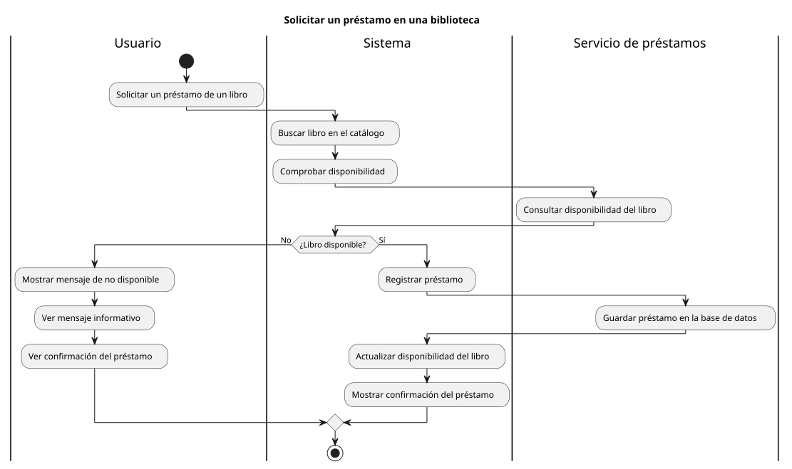

# Diagrama de actividad

Un **diagrama de actividad** es un diagrama [UML](https://www.ibm.com/docs/es/iis/11.5.0?topic=types-unified-modeling-language-uml-model) (Lenguaje Unificado de Modelado) que representa el **flujo de trabajo de un proceso**, mostrando las actividades que se realizan, el orden en que se ejecutan y las decisiones que pueden modificar el recorrido.

Se utiliza para describir el comportamiento de un sistema mediante una secuencia de acciones, desde un punto de inicio hasta uno o varios puntos de finalización. Es especialmente útil para representar procesos de negocio, algoritmos y flujos de trabajo de una aplicación.

A diferencia del [diagrama de secuencia](secuencia.md), que se centra en los mensajes intercambiados entre participantes a lo largo del tiempo, el diagrama de actividad se centra en las **acciones que componen un proceso** y el flujo que las conecta.

## Ejemplo

A continuación se presenta un <span class="example">ejemplo:material-flash:</span> de **diagrama de casos de uso** para un _Sistema de gestión de una biblioteca_:



??? success "Código PlantUML"

    [PlantUML](https://plantuml.com/) es un sabor («flavour») de UML para diseñar diagramas mediante código. Su herramienta _online_ [PlantText](https://www.planttext.com/) permite crear y editar los ficheros (diagramas) directamente en el navegador.

    A continuación se muestra el código que ha permitido generar el [diagrama de actividad](https://plantuml.com/es/activity-diagram-beta) del ejemplo anterior:

    ```linenums="1"
    @startuml

    title Solicitar un préstamo en una biblioteca

    |Usuario|
    start
    :Solicitar un préstamo de un libro;
    |Sistema|
    :Buscar libro en el catálogo;
    :Comprobar disponibilidad;
    |Servicio de préstamos|
    :Consultar disponibilidad del libro;
    |Sistema|
    if (¿Libro disponible?) then (No)
    |Usuario|
    :Mostrar mensaje de no disponible;
    :Ver mensaje informativo;
    :Ver confirmación del préstamo;
    else (Sí)
    |Sistema|
    :Registrar préstamo;
    |Servicio de préstamos|
    :Guardar préstamo en la base de datos;
    |Sistema|
    :Actualizar disponibilidad del libro;
    :Mostrar confirmación del préstamo;
    endif
    stop

    @enduml
    ```
