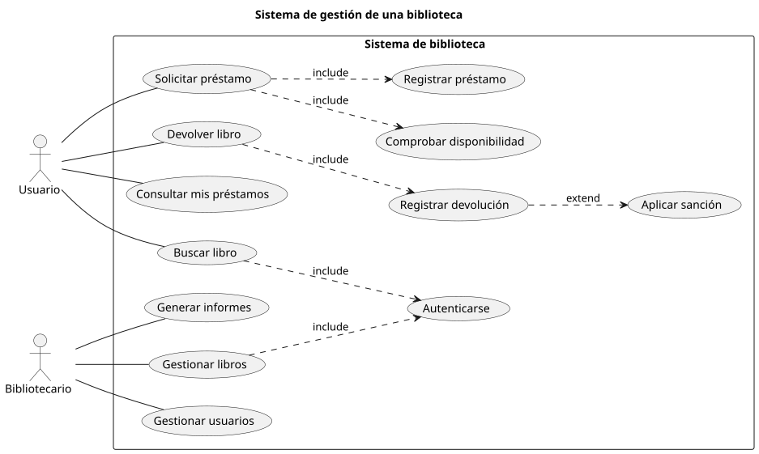

# Diagrama de casos de uso

Un **diagrama de casos de uso** es un diagrama [UML](https://www.ibm.com/docs/es/iis/11.5.0?topic=types-unified-modeling-language-uml-model) (Lenguaje Unificado de Modelado) que representa las **funcionalidades que ofrece un sistema** y los usuarios u otros sistemas externos que interactúan con él.

Se utiliza para describir qué puede hacer un sistema desde el punto de vista de sus usuarios, sin entrar en los detalles de cómo se implementan esas funcionalidades. Es especialmente útil durante las primeras fases del desarrollo de software, ya que permite identificar y documentar los requisitos funcionales de una aplicación.

## Ejemplo

A continuación se presenta un <span class="example">ejemplo:material-flash:</span> de **diagrama de casos de uso** para un _Sistema de gestión de una biblioteca_:



??? success "Código PlantUML"

    [PlantUML](https://plantuml.com/) es un sabor («flavour») de UML para diseñar diagramas mediante código. Su herramienta _online_ [PlantText](https://www.planttext.com/) permite crear y editar los ficheros (diagramas) directamente en el navegador.

    A continuación se muestra el código que ha permitido generar el [diagrama de casos de uso](https://plantuml.com/es/use-case-diagram) del ejemplo anterior:

    ```linenums="1"
    @startuml

    title Sistema de gestión de una biblioteca
    left to right direction

    actor Usuario as user
    actor Bibliotecario as bib

    rectangle "Sistema de biblioteca" {
      usecase "Buscar libro" as buscar
      usecase "Solicitar préstamo" as solic
      usecase "Devolver libro" as devolver
      usecase "Consultar mis préstamos" as consultar  
      usecase "Autenticarse" as auth
      usecase "Comprobar disponibilidad" as disp
      usecase "Registrar préstamo" as regpres
      usecase "Registrar devolución" as regdev
      usecase "Aplicar sanción" as sanc
      usecase "Gestionar libros" as gestlib
      usecase "Gestionar usuarios" as gestuser
      usecase "Generar informes" as informes
    }


    user -- buscar
    user -- solic
    user -- devolver
    user -- consultar

    bib -- gestlib
    bib -- gestuser
    bib -- informes

    buscar ..> auth : include
    solic ..> disp : include
    solic ..> regpres : include
    devolver ..> regdev : include
    regdev ..> sanc : extend
    gestlib ..> auth : include

    @enduml
    ```
