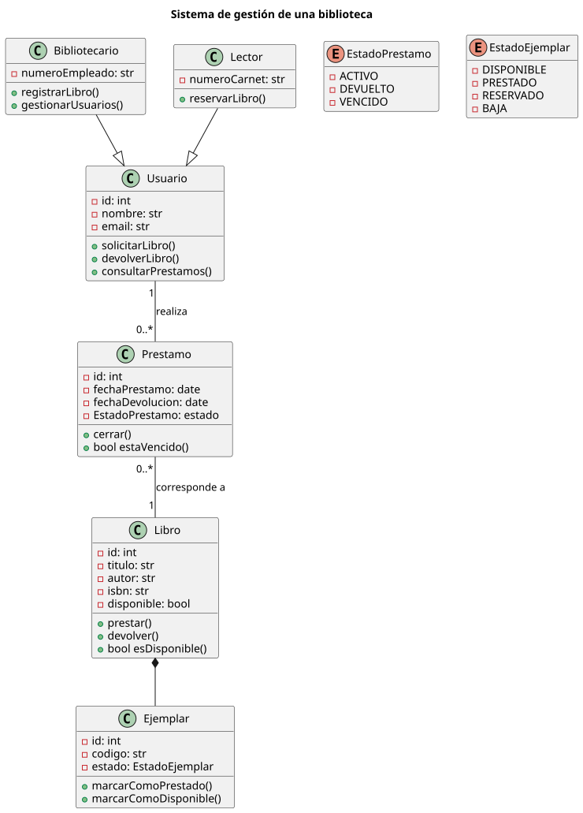

# Diagrama de clases

Un **diagrama de clases** es un diagrama [UML](https://www.ibm.com/docs/es/iis/11.5.0?topic=types-unified-modeling-language-uml-model) (Lenguaje Unificado de Modelado) que representa la **estructura estática de un sistema**. Permite identificar las clases que lo componen, sus atributos, sus métodos y las relaciones que existen entre ellas.

Se utiliza principalmente durante el diseño de software orientado a objetos para representar cómo se organiza un sistema antes de implementarlo mediante código.

## Ejemplo

A continuación se presenta un <span class="example">ejemplo:material-flash:</span> de **diagrama de clases** para un _Sistema de gestión de una biblioteca_:



??? success "Código PlantUML"

    [PlantUML](https://plantuml.com/) es un sabor («flavour») de UML para diseñar diagramas mediante código. Su herramienta _online_ [PlantText](https://www.planttext.com/) permite crear y editar los ficheros (diagramas) directamente en el navegador.

    A continuación se muestra el código que ha permitido generar el [diagrama de clases](https://plantuml.com/es/class-diagram) del ejemplo anterior:

    ```linenums="1"
    @startuml

    hide empty members

    title Sistema de gestión de una biblioteca

    class Usuario {
    -id: int
    -nombre: str
    -email: str
    +solicitarLibro()
    +devolverLibro()
    +consultarPrestamos()
    }

    class Prestamo {
    -id: int
    -fechaPrestamo: date
    -fechaDevolucion: date
    -EstadoPrestamo: estado
    +cerrar()
    +bool estaVencido()
    }

    class Libro {
    -id: int
    -titulo: str
    -autor: str
    -isbn: str
    -disponible: bool
    +prestar()
    +devolver()
    +bool esDisponible()
    }

    class Bibliotecario {
    -numeroEmpleado: str
    +registrarLibro()
    +gestionarUsuarios()
    }

    class Lector {
    -numeroCarnet: str
    +reservarLibro()
    }

    class Ejemplar {
    -id: int
    -codigo: str
    -estado: EstadoEjemplar
    +marcarComoPrestado()
    +marcarComoDisponible()
    }

    enum EstadoPrestamo {
    -ACTIVO
    -DEVUELTO
    -VENCIDO
    }

    enum EstadoEjemplar {
    -DISPONIBLE
    -PRESTADO
    -RESERVADO
    -BAJA
    }

    Usuario "1" -- "0..*" Prestamo : realiza
    Prestamo "0..*" -- "1" Libro : corresponde a
    Bibliotecario --|> Usuario
    Lector --|> Usuario
    Libro *-- Ejemplar

    @enduml
    ```
