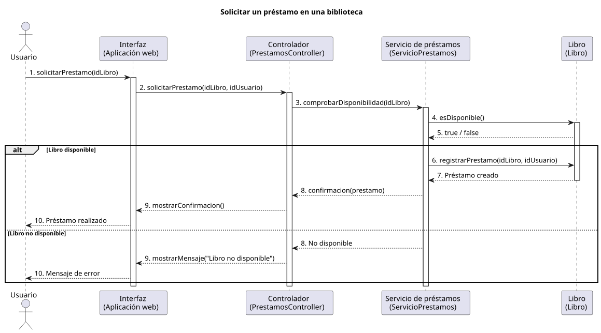

# Diagrama de secuencia

Un **diagrama de secuencia** es un diagrama [UML](https://www.ibm.com/docs/es/iis/11.5.0?topic=types-unified-modeling-language-uml-model) (Lenguaje Unificado de Modelado) que representa las **interacciones entre los distintos participantes de un sistema** a lo largo del tiempo. Muestra los mensajes que intercambian los objetos y el orden en el que se producen.

Se utiliza para describir cómo colaboran los diferentes componentes de una aplicación para realizar una operación concreta, como iniciar sesión, realizar una compra o solicitar un préstamo.

A diferencia del [diagrama de clases](clases.md), que representa la estructura estática del sistema, el diagrama de secuencia muestra su **comportamiento dinámico**, centrándose en el orden temporal de las interacciones.

## Ejemplo

A continuación se presenta un <span class="example">ejemplo:material-flash:</span> de **diagrama de casos de uso** para un _Sistema de gestión de una biblioteca_:



??? success "Código PlantUML"

    [PlantUML](https://plantuml.com/) es un sabor («flavour») de UML para diseñar diagramas mediante código. Su herramienta _online_ [PlantText](https://www.planttext.com/) permite crear y editar los ficheros (diagramas) directamente en el navegador.

    A continuación se muestra el código que ha permitido generar el [diagrama de secuencia](https://plantuml.com/es/sequence-diagram) del ejemplo anterior:

    ```linenums="1"
    @startuml

    title Solicitar un préstamo en una biblioteca

    actor Usuario as usuario
    participant "Interfaz\n(Aplicación web)" as interfaz
    participant "Controlador\n(PrestamosController)" as controlador
    participant "Servicio de préstamos\n(ServicioPrestamos)" as servicio
    participant "Libro\n(Libro)" as libro

    usuario -> interfaz : 1. solicitarPrestamo(idLibro)
    activate interfaz
    interfaz -> controlador : 2. solicitarPrestamo(idLibro, idUsuario)
    activate controlador
    controlador -> servicio : 3. comprobarDisponibilidad(idLibro)
    activate servicio
    servicio -> libro : 4. esDisponible()
    activate libro
    libro --> servicio : 5. true / false

    alt Libro disponible
    servicio -> libro : 6. registrarPrestamo(idLibro, idUsuario)
    libro --> servicio : 7. Préstamo creado
    deactivate libro
    servicio --> controlador : 8. confirmacion(prestamo)
    controlador --> interfaz : 9. mostrarConfirmacion()
    interfaz --> usuario : 10. Préstamo realizado
    else Libro no disponible
    servicio --> controlador : 8. No disponible
    controlador --> interfaz : 9. mostrarMensaje("Libro no disponible")
    interfaz --> usuario : 10. Mensaje de error
    end

    deactivate interfaz
    deactivate controlador
    deactivate servicio

    @enduml
    ```
