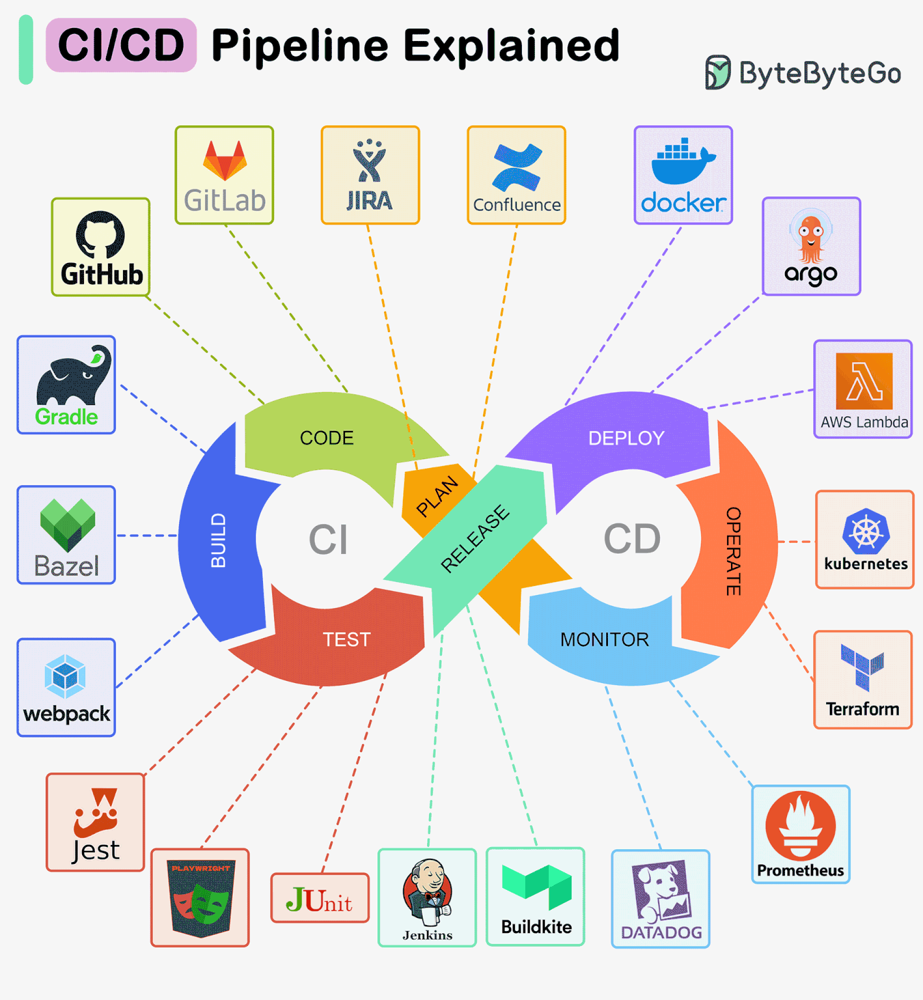
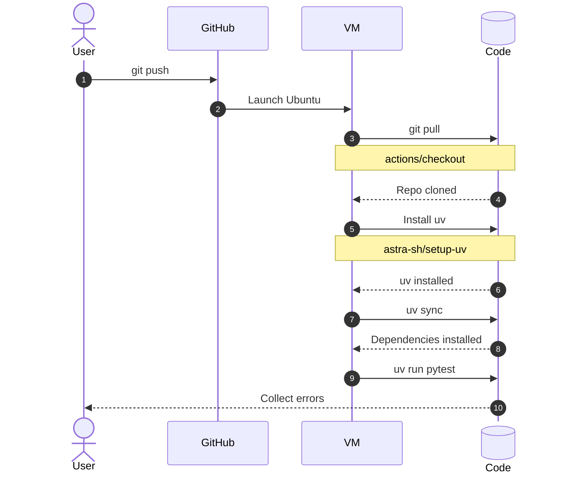
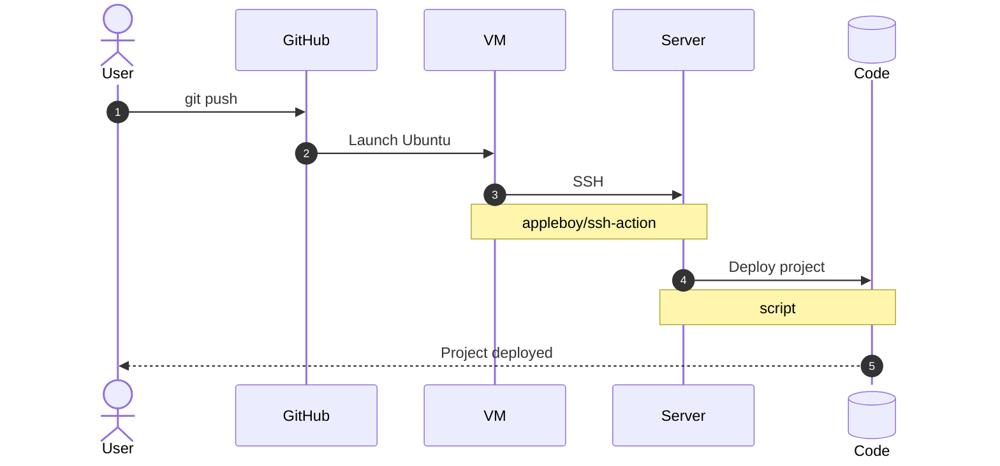

# CI/CD


/// caption
Imagen generada con Inteligencia Artificial
///

CI/CD es una **metodología** de desarrollo de software que **automatiza** las fases de compilación, prueba e implementación de aplicaciones. Se trata de un término que suele ir «en pack» pero que tiene significados diferentes:

CI
: La **integración continua (CI)** es una práctica de desarrollo de software que consiste en integrar frecuentemente los cambios realizados por los desarrolladores en un repositorio compartido. Cada integración puede activar automáticamente una serie de comprobaciones, como la ejecución de pruebas y el análisis del código, para detectar errores lo antes posible.

CD
: La **entrega/despliegue continuo (CD)** son prácticas que permiten automatizar las etapas posteriores a la integración continua, facilitando que el software llegue a los usuarios de forma rápida y fiable. Consiste en mantener el software preparado para su publicación en cualquier momento, aunque el paso a producción puede requerir una aprobación manual.

## Herramientas

Actualmente se ofrecen múltiples herramientas que pueden intervenir en un «ciclo» CI/CD. Su elección depende del proceso que queramos cubrir y de las necesidades detectadas en nuestro contexto:


///caption
Fuente: <https://news.abnasia.org/es/blog/es/es-explicacion-de-la-pipeline-ci-cd-6030>
///

## GitHub Actions

[GitHub Actions](https://github.com/features/actions) se ha convertido en una de las herramientas CI/CD más populares por las siguientes ventajas:

- **Integración con [GitHub](https://github.com)**: permite ejecutar procesos automáticamente cuando se producen eventos en un repositorio, como un **push** o la creación de una «pull request».
- **Configuración sencilla**: los [flujos de trabajo («workflows»)](https://docs.github.com/en/actions/concepts/workflows-and-actions/workflows) se definen mediante archivos [YAML](https://learnxinyminutes.com/yaml/) almacenados en el propio repositorio.
- **Ejecución automatizada**: permite ejecutar pruebas, analizar código, generar paquetes y desplegar aplicaciones.
- **Ecosistema de acciones**: dispone de un [amplio catálogo de acciones](https://github.com/marketplace?type=actions) reutilizables que facilitan la configuración de tareas habituales.
- **Infraestructura gestionada**: ofrece [máquinas virtuales](https://docs.github.com/es/actions/concepts/runners/github-hosted-runners) preparadas para ejecutar los flujos de trabajo, sin necesidad de administrar servidores propios.
- **Flexibilidad**: permite trabajar con diferentes lenguajes de programación, sistemas operativos y herramientas de desarrollo.
- **Plan gratuito**: ofrece minutos de ejecución gratuitos bajo determinadas condiciones, lo que facilita su uso en proyectos personales y educativos.

!!! info "Flujos de trabajo"

    Los _workflows_ de GitHub Actions se deben crear en la carpeta `.github/workflows/*.yml` de nuestro proyecto.

### Ejecutar pruebas

Veamos a continuación un <span class="example">ejemplo:material-flash:</span> de _workflow_ para automatizar las [pruebas](../pruebas/) de un proyecto [Python](../desarrollo/python.md) gestionado[^1] mediante [uv](../ide/uv.md):

```yaml title=".github/workflows/tests.yml" linenums="1"
name: Tests #(1)!

on: #(2)!
  push: #(3)!
  pull-request: #(4)!

jobs: #(5)!
  test:
    runs-on: ubuntu-latest #(6)!

    steps: #(7)!
      - name: Descargar el código #(8)!
        uses: actions/checkout@v4 #(9)!

      - name: Instalar uv #(10)!
        uses: astral-sh/setup-uv@v10.3.0 #(11)!

      - name: Instalar dependencias #(12)!
        run: uv sync --locked #(13)!

      - name: Ejecutar pruebas #(14)!
        run: uv run pytest #(15)!
```
{ .annotate }

1. La clave [`name`](https://docs.github.com/es/actions/reference/workflows-and-actions/workflow-syntax#name) establece el nombre del _workflow_.
2.  - La clave [`on`](https://docs.github.com/es/actions/reference/workflows-and-actions/workflow-syntax#on) establece cuándo se lanzara el _workflow_.
3.  - Indica que este _workflow_ se lanzará cuando se haga un `git push` sobre el repositorio.
    - Se recomienda consultar las [opciones de configuración](https://docs.github.com/es/actions/reference/workflows-and-actions/events-that-trigger-workflows#push) de `push`.
4.  - Indica que este _workflow_ se lanzará cuando se reciba un «pull request» en el repositorio.
    - Se recomienda consultar las [opciones de configuración](https://docs.github.com/es/actions/reference/workflows-and-actions/events-that-trigger-workflows#pull_request) de «pull request».
5. La clave [`jobs`](https://docs.github.com/es/actions/reference/workflows-and-actions/workflow-syntax#jobs) establece la lista de trabajos a realizar.
6. La clave [`runs-on`](https://docs.github.com/es/actions/reference/workflows-and-actions/workflow-syntax#jobsjob_idruns-on) establece la [imagen de sistema operativo](https://github.com/actions/runner-images) (_runner_) sobre la que se ejecutará.
7. La clave [`steps`](https://docs.github.com/es/actions/reference/workflows-and-actions/workflow-syntax#jobsjob_idsteps) establece las tareas (_pasos_) a ejecutar dentro del trabajo en cuestión.
8. La clave [`name`](https://docs.github.com/es/actions/reference/workflows-and-actions/workflow-syntax#jobsjob_idstepsname) establece un nombre para la tarea.
9.  - La clave [`uses`](https://docs.github.com/es/actions/reference/workflows-and-actions/workflow-syntax#jobsjob_idstepsuses) establece la [acción](https://github.com/marketplace?type=actions) a ejecutar.
    - En este caso [`actions/checkout@v4`](https://github.com/marketplace/actions/checkout#checkout-v4) es una acción predefinida que se encarga de «descargar» (clonar) el repositorio actual en el _runner_ especificado previamente.
    - Nótese que al indicar `@v4` estamos seleccionando la versión 4 de la acción. Es **obligatorio** especificar una versión concreta de la acción elegida.
10. La clave [`name`](https://docs.github.com/es/actions/reference/workflows-and-actions/workflow-syntax#jobsjob_idstepsname) establece un nombre para la tarea.
11.  - La clave [`uses`](https://docs.github.com/es/actions/reference/workflows-and-actions/workflow-syntax#jobsjob_idstepsuses) establece la [acción](https://github.com/marketplace?type=actions) a ejecutar.
    - En este caso [`astral-sh/setup-uv@@v10.3.0`](https://github.com/marketplace/actions/astral-sh-setup-uv) es una acción predefinida que se encarga de instalar [uv](../ide/uv.md) en el _runner_ especificado previamente.
    - Nótese que al indicar `@v10.3.0` estamos seleccionando la versión 10.3.0 de la acción. Es **obligatorio** especificar una versión concreta de la acción elegida.
12. La clave [`name`](https://docs.github.com/es/actions/reference/workflows-and-actions/workflow-syntax#jobsjob_idstepsname) establece un nombre para la tarea.
13. - La clave [`run`](https://docs.github.com/es/actions/reference/workflows-and-actions/workflow-syntax#jobsjob_idstepsrun) establece el comando a ejecutar.
    - Si los comandos ocupan varias líneas la sintaxis cambia ligeramente usando `|` como separador. Por <span class="example">ejemplo:material-flash:</span>:
    ```yaml
    - name: Clean install dependencies and build
      run: |
        npm ci
        npm run build
    ```
    - En este caso [`uv sync`](../ide/uv.md#sincronizar-dependencias) sincroniza las dependencias del proyecto.
14. La clave [`name`](https://docs.github.com/es/actions/reference/workflows-and-actions/workflow-syntax#jobsjob_idstepsname) establece un nombre para la tarea.
15. - La clave [`run`](https://docs.github.com/es/actions/reference/workflows-and-actions/workflow-syntax#jobsjob_idstepsrun) establece el comando a ejecutar.
    - Si los comandos ocupan varias líneas la sintaxis cambia ligeramente usando `|` como separador. Por <span class="example">ejemplo:material-flash:</span>:
    ```yaml
    - name: Clean install dependencies and build
      run: |
        npm ci
        npm run build
    ```
    - En este caso [`uv run pytest`](../../paquetes/pruebas/pytest.md#lanzando-tests) lanza los _tests_ mediante el paquete `pytest`.

Este _workflow_ se puede representar gráficamente mediante el siguiente diagrama:



### Distintas versiones

Veamos a continuación un <span class="example">ejemplo:material-flash:</span> de _workflow_ para automatizar las [pruebas](../pruebas/) de un proyecto [Python](../desarrollo/python.md) gestionado[^1] mediante [uv](../ide/uv.md) pero **variando las versiones de Python**:

```yaml title=".github/workflows/tests.yml" linenums="1" hl_lines="10-12"
name: Tests

on:
  push:
  pull-request:

jobs:
  test:
    runs-on: ubuntu-latest

    strategy: #(1)!
      matrix: #(2)!
        python-version: ["3.13", "3.14"] #(3)!

    steps:
      - name: Descargar el código
        uses: actions/checkout@v4

      - name: Instalar uv
        uses: astral-sh/setup-uv@v6

      - name: Instalar Python
        run: uv python install ${{ matrix.python-version }}

      - name: Instalar dependencias
        run: uv sync --locked --python ${{ matrix.python-version }}

      - name: Ejecutar pruebas
        run: uv run --python ${{ matrix.python-version }} pytest
```
{ .annotate }

1. La clave [`strategy`](https://docs.github.com/es/actions/reference/workflows-and-actions/workflow-syntax#jobsjob_idstrategy) establece una **estrategia de matriz** para el _workflow_.
2. La clave [`matrix`](https://docs.github.com/es/actions/reference/workflows-and-actions/workflow-syntax#jobsjob_idstrategymatrix) establece una matriz de diferentes configuraciones de trabajo para el _workflow_.
3. La clave `python-version` es una _clave de usuario_ que en este caso define las distintas versiones de Python contra las que se probará el código.

### Calidad de código

Veamos a continuación un <span class="example">ejemplo:material-flash:</span> de _workflow_ para comprobar la calidad del código de un proyecto [Python](../desarrollo/python.md) gestionado[^2] mediante [uv](../ide/uv.md):

```yaml title=".github/workflows/quality.yml" linenums="1" hl_lines="21-22 24-25"
name: Quality

on:
  push:
  pull_request:

jobs:
  quality:
    runs-on: ubuntu-latest

    steps:
      - name: Descargar el código
        uses: actions/checkout@v4

      - name: Instalar uv
        uses: astral-sh/setup-uv@v6

      - name: Instalar dependencias
        run: uv sync --locked

      - name: Comprobar el formato
        run: uv run ruff format --check .

      - name: Analizar el código
        run: uv run ruff check .

      - name: Ejecutar pruebas
        run: uv run pytest
```

### Despliegue

Veamos a continuación un <span class="example">ejemplo:material-flash:</span> de _workflow_ para **desplegar** un proyecto [Django](../../paquetes/web/django/) gestionado mediante [uv](../ide/uv.md):

```yaml title=".github/workflows/deploy.yml" linenums="1" hl_lines="5-6 13-25"
name: Deploy

on:
  push:
    branches: #(1)!
      - main #(2)!

jobs:
  deploy:
    runs-on: ubuntu-latest

    steps:
      - name: Desplegar aplicación
        uses: appleboy/ssh-action@v1 #(3)!
        with: #(4)!
          host: ${{ secrets.SSH_HOST }} #(5)!
          username: ${{ secrets.SSH_USER }} #(6)!
          key: ${{ secrets.SSH_PRIVATE_KEY }} #(7)!
          script: | #(8)!
            cd /srv/mi-proyecto
            git pull --ff-only
            uv sync --locked
            uv run python manage.py migrate --noinput
            uv run python manage.py collectstatic --noinput
            sudo systemctl restart mi-proyecto
```
{ .annotate }

1. La clave [`branches`](https://docs.github.com/es/actions/reference/workflows-and-actions/workflow-syntax#onpushbranchestagsbranches-ignoretags-ignore) establece las ramas que dispararán el _workflow_.
2. Únicamente cuando se haga un `git push` sobre la rama `main` se ejecutará este _workflow_.
3. Utilizamos la acción [`appleboy/ssh-action@v1`](https://github.com/marketplace/actions/ssh-remote-commands) que nos permite conectarnos a un servidor remoto mediante protocolo SSH.
4. La clave `with` establece los ajustes de conexión.
5.  - La clave `host` establece el **servidor** al que conectar.
    - El valor `${{ secrets.SSH_HOST }}` hace referencia al [secreto](https://docs.github.com/es/actions/how-tos/write-workflows/choose-what-workflows-do/use-secrets) `SSH_HOST` definido en GitHub.
6.  - La clave `username` establece el **usuario** con el que conectar al servidor.
    - El valor `${{ secrets.SSH_USER }}` hace referencia al [secreto](https://docs.github.com/es/actions/how-tos/write-workflows/choose-what-workflows-do/use-secrets) `SSH_USER` definido en GitHub.
7.  - La clave `key` establece la **clave privada** con la que conectar al servidor.
    - El valor `${{ secrets.SSH_PRIVATE_KEY }}` hace referencia al [secreto](https://docs.github.com/es/actions/how-tos/write-workflows/choose-what-workflows-do/use-secrets) `SSH_PRIVATE_KEY` definido en GitHub.
8.  - La clave `script` establece los **comandos** (_script_) a ejecutar en el servidor.
    - Más información sobre despliegue de Django [aquí](../../paquetes/web/django/produccion.md#despliegue).

Este _workflow_ se puede representar gráficamente mediante el siguiente diagrama:




[^1]: Se debe haber añadido **dependencias de desarrollo** en el proyecto: `#!console uv add --dev pytest`
[^2]: Se debe haber añadido **dependencias de desarrollo** en el proyecto: `#!console uv add --dev ruff pytest`
