# Git

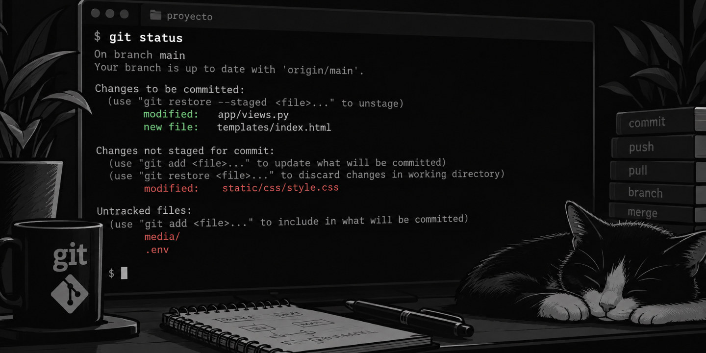
/// caption
Imagen generada con Inteligencia Artificial
///

## Introducción al control de versiones

Supongamos que queremos ir gestionando los cambios que realizamos sobre un determinado archivo en el que estamos trabajando.

Sabemos que, por desgracia, podemos terminar :scream: con algo similar a esto:

```console
~/data$ ls -l
procesa_datos_00.R
procesa_datos_01.R
procesa_datos_02.R
procesa_datos_03.R
procesa_datos_04.R
procesa_datos_05.R
procesa_datos_06.R
procesa_datos_07.R
procesa_datos_08.R
procesa_datos_09.R
procesa_datos_10.R
procesa_datos_11.R
procesa_datos_12.R
procesa_datos_13.R
procesa_datos_14.R
procesa_datos_15.R
procesa_datos_16.R
procesa_datos_17.R
procesa_datos_18.R
procesa_datos_19.R
procesa_datos_20.R
```

Quizás en otro proyecto lo podamos gestionar mediante la creación de carpetas:

```console
~/web$ tree
.
├── cambios
│   ├── arregla_error1
│   ├── arreglando_procesa
│   ├── mejora_funcionalidad
│   ├── nuevo_problema
│   └── soluciona_bug
├── definitivo
│   ├── lanzamiento
│   ├── version_final
│   └── version_mejorada
└── pruebas
    ├── pruebas_antes
    ├── pruebas_despues
    └── pruebas_final

14 directories, 0 files
```

En ambos casos se intuye que el **mantenimiento** a largo plazo de los cambios no parece tarea sencilla y es muy probable que nos lleve a cometer errores y a bajar nuestra productividad.

:material-lightbulb-on-40:{.acc} Se llama **control de versiones** a la gestión de los diversos **cambios** que se realizan sobre los elementos de algún producto o una configuración del mismo. Una versión, revisión o edición de un producto, es el **estado** en el que se encuentra el mismo en un momento dado de su desarrollo o modificación.

[Git :simple-git:](https://git-scm.com/) es un **sistema de control de versiones distribuido** diseñado para manejar **proyectos de software** con rapidez y eficiencia.

### Aclarando conceptos

Hay que diferenciar los distintos tipos de artefactos que participan de un sistema de control de versiones:

=== "CLI :octicons-terminal-16:"

    Herramientas en línea de comandos:

    | Herramienta | Descripción | Lanzamiento |
    | --- | --- | --- |
    | [CVS](https://es.wikipedia.org/wiki/CVS) | Sistema concurrente de versiones | 1990 |
    | [Subversion :simple-subversion:](https://subversion.apache.org/) | Control de versiones ^^centralizado^^ (SVN) | 2000 |
    | [Mercurial :simple-mercurial:](https://www.mercurial-scm.org/) | Herramienta distribuida de gestión de código fuente | 2005 |
    | [Git :simple-git:](https://git-scm.com/) | Sistema de control de versiones ^^distribuido^^ | 2005 |

=== "GUI :material-television-guide:"

    Interfaces gráficas de usuario:

    | Herramienta | Descripción | Lanzamiento |
    | --- | --- | --- |
    | [TortoiseGit :material-tortoise:](https://tortoisegit.org/) | Cliente de escritorio para git | 2008 |
    | [GitKraken :simple-gitkraken:](https://gitkraken.com/) | Cliente de escritorio para git | 2014 |
    | [GitHub Desktop :simple-github:](https://desktop.github.com/) | Cliente de escritorio para git | 2015 |
    | [VSCode :material-microsoft-visual-studio-code:](https://code.visualstudio.com/docs/sourcecontrol/overview) | Cliente de escritorio para git | 2015 |

=== "Web :material-web:"

    Servicios web:

    | Herramienta | Descripción | Lanzamiento |
    | --- | --- | --- |
    | [GitHub :simple-github:](https://github.com) | Servicio web de control de versiones | 2008 |
    | [Bitbucket :simple-bitbucket:](https://bitbucket.org/) | Servicio web de control de versiones | 2008 |
    | [GitLab :simple-gitlab:](https://gitlab.com/) | Servicio web de control de versiones | 2011 |
        
### Centralizado vs Distribuido

Es interesante conocer las diferencias entre un sistema de control de versiones centralizado y otro distribuido. En este caso pondremos como <span class="example">ejemplo:material-flash:</span> **SVN** _vs_ **GIT**.

<div class="grid cards" markdown>

-   :simple-subversion:{.lg .middle} **SVN**

    ---

    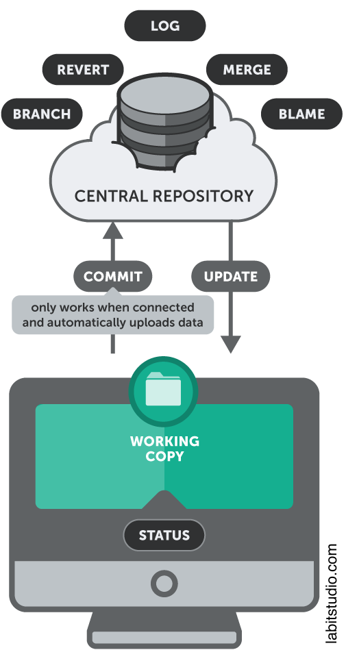

-   :simple-git:{.lg .middle} **GIT**

    ---

    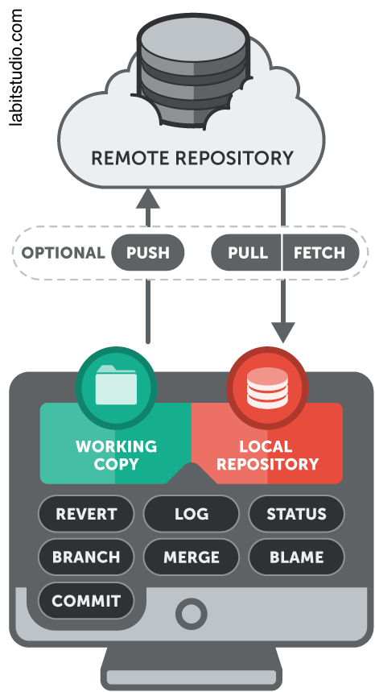

</div>

!!! note "Porcentaje de uso"

    A fecha de 2026, se estima que GIT se utiliza en torno al 95% de los proyectos de software que emplean control de versiones, frente a un 5% de SVN.

### ¿Por qué git?

Tras analizar todo lo anteriormente dicho, la eleción de `git` como sistema de **control de versiones** se fundamenta en varios aspectos:

1. Histórico permanente de cambios.
2. Copias de seguridad.
3. Trabajo en equipo.
4. Creación de ramas y/o etiquetas.
5. Enfoque social.

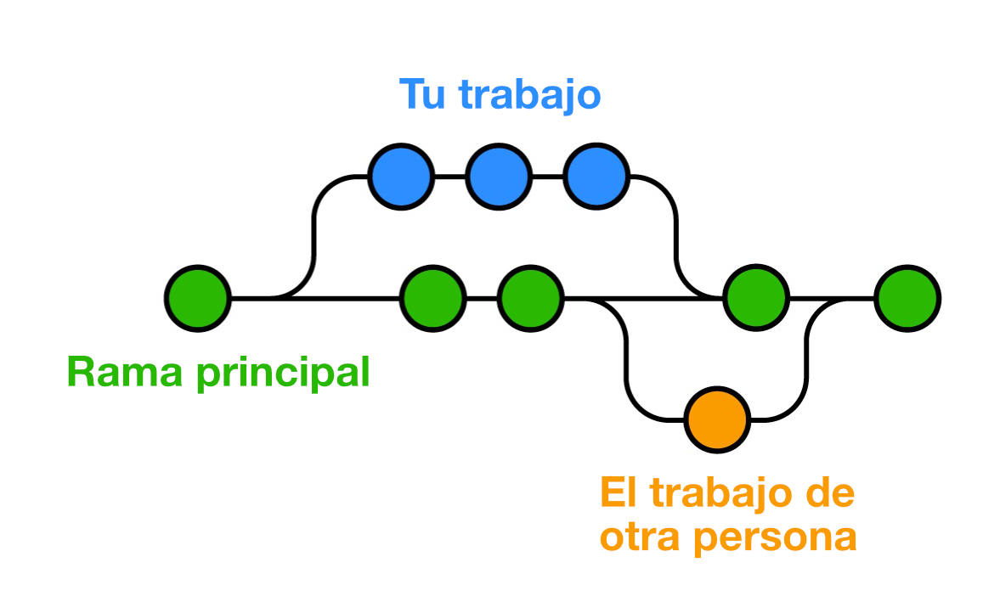
///caption
Flujo de trabajo en Git
///

## Preparación del entorno de desarrollo

Para empezar a trabajar con `git` necesitamos preparar nuestro entorno de desarrolo.

### Instalación de git

Git ofrece desde su web una enorme variedad de formas de instalar la herramienta para todos los sistemas operativos. Simplemente consulta [este enlace](https://git-scm.com/install/) y selecciona la que te interese.

Podemos comprobar que disponemos de `git` ejecutando el siguiente comando:

```console
$ git --version #(1)!
git version 2.50.1 (Apple Git-155)
```
{ .annotate }

1. Puede que en tu caso no coincida la versión ni la plataforma. No es importante. Simplemente tiene que ver con el momento y el equipo donde se ha instalado. En mi caso es sobre macOS.

### Credenciales

Lo primero que se debería hacer al trabajar con `git` es establecer las credenciales, así nuestras acciones estarán identificadas por el sujeto que las hace.

Para ello ejecutamos:

```console
$ git config --global user.name "Sergio Delgado Quintero" #(1)!
$ git config --global user.email "sdelquin@gmail.com" #(2)!
```
{ .annotate }

1. El hecho de usar `--global` nos permite configurar nuestras credenciales para todos los proyectos que hagamos en el ordenador. Sin ello, se pueden definir credenciales distintas por cada proyecto.
2. El hecho de usar `--global` nos permite configurar nuestras credenciales para todos los proyectos que hagamos en el ordenador. Sin ello, se pueden definir credenciales distintas por cada proyecto.

El comando anterior crea un archivo `~/.gitconfig` con los datos especificados previamente:

```ini
[user]
  name = Sergio Delgado Quintero
  email = sdelquin@gmail.com
```

Aunque no es estrictamente necesario sí es **recomendable** fijar la **rama por defecto** a _main_[^1] para nuevos proyectos:

```console
$ git config --global init.defaultBranch main #(1)!
```
{ .annotate }

1. Esto añadirá el siguiente bloque al fichero `~/.gitconfig`:

    ```ini
    [init]
      defaultBranch = main 
    ```

### Inicializar un repositorio

Ya estamos en disposición de crear (inicializar) nuestro primer repositorio `git`. Antes de nada crearemos una carpeta donde vayamos a trabajar:

```console
$ mkdir work && cd work
```

El comando **`git init`**[:octicons-link-external-16:](https://git-scm.com/docs/git-init) es el que se utiliza para **inicializar un repositorio** dentro del control de versiones.

```console
$ git init
Initialized empty Git repository in /Users/sdelquin/work/.git/
```

Lo «único» que hace el comando anterior es crear una carpeta `.git` que contendrá toda la información necesaria para poder llevar el control de versiones de nuestro proyecto:

```console
$ tree .git
.git
├── config
├── description
├── HEAD
├── hooks
│   ├── applypatch-msg.sample
│   ├── commit-msg.sample
│   ├── fsmonitor-watchman.sample
│   ├── post-update.sample
│   ├── pre-applypatch.sample
│   ├── pre-commit.sample
│   ├── pre-merge-commit.sample
│   ├── pre-push.sample
│   ├── pre-rebase.sample
│   ├── pre-receive.sample
│   ├── prepare-commit-msg.sample
│   ├── push-to-checkout.sample
│   ├── sendemail-validate.sample
│   └── update.sample
├── info
│   └── exclude
├── objects
│   ├── info
│   └── pack
└── refs
    ├── heads
    └── tags
```

### Clonar un repositorio

Si el proyecto con el que vamos a trabajar ya existe en un _servicio web_ (tipo GitHub), en vez de inicializarlo en nuestra máquina podemos «traernos» su contenido.

Esto se conoce como **clonar un repositorio** y hay dos maneras de hacerlo:

=== "Clonado vía **ssh** :material-ssh:{.lg .middle}"

    ```console
    $ git clone git@github.com:sdelquin/work.git
    ```

    :octicons-key-16: En este caso la **autenticación** se produce utilizando **clave pública/privada**.

=== "Clonado vía **https** :material-web:{.lg .middle}"

    ```console
    $ git clone https://github.com/sdelquin/work.git
    ```

    :octicons-key-16: En este caso la **autenticación** se produce utilizando **usuario y token**.
    
## Flujo de trabajo

El flujo habitual de trabajo en un repositorio `git` suele ser el siguiente:

:one: `git pull` :material-arrow-right: Esto nos actualiza los cambios del _remoto_.  
> Trabajar en el proyecto con normalidad, añadiendo, modificando o borrando archivos.  

:two: `git status` :material-arrow-right: Indica la situación actual del repositorio.  
:three: `git add .` :material-arrow-right: Prepara los cambios efectuados para control de versiones.  
:four: `git commit -m "Mi trabajo de hoy"` :material-arrow-right: Confirma los cambios.  
:five: `git push` :material-arrow-right: Sube los cambios al _remoto_.

## Comandos en detalle

Para explicar todo lo que viene a continuación empezamos desde aquí:

```console
$ git clone git@github.com:sdelquin/work.git #(1)!
$ cd work
$ ls
LICENSE   README.md
```
{ .annotate }

1. Clonado mediante **ssh**.

### Comprobar el estado

El comando **`git status`**[:octicons-link-external-16:](https://git-scm.com/docs/git-status) es el que se utiliza para **comprobar el estado del repositorio** dentro del control de versiones.

```console
$ git status
On branch main
Your branch is up to date with 'origin/main'.
 
nothing to commit, working tree clean
```

Ahora por <span class="example">ejemplo:material-flash:</span> supongamos que modificamos el archivo `README.md`:

```console hl_lines="8"
$ git status
On branch main
Your branch is up to date with 'origin/main'.
 
Changes not staged for commit:
  (use "git add [file]..." to update what will be committed)
  (use "git restore [file]..." to discard changes in working directory)
  modified:   README.md
 
no changes added to commit (use "git add" and/or "git commit -a")
```

#### Estados de un archivo

A continuación se presentan los posibles estados de un archivo en `git` y la forma de pasar de uno a otro mediante comandos:

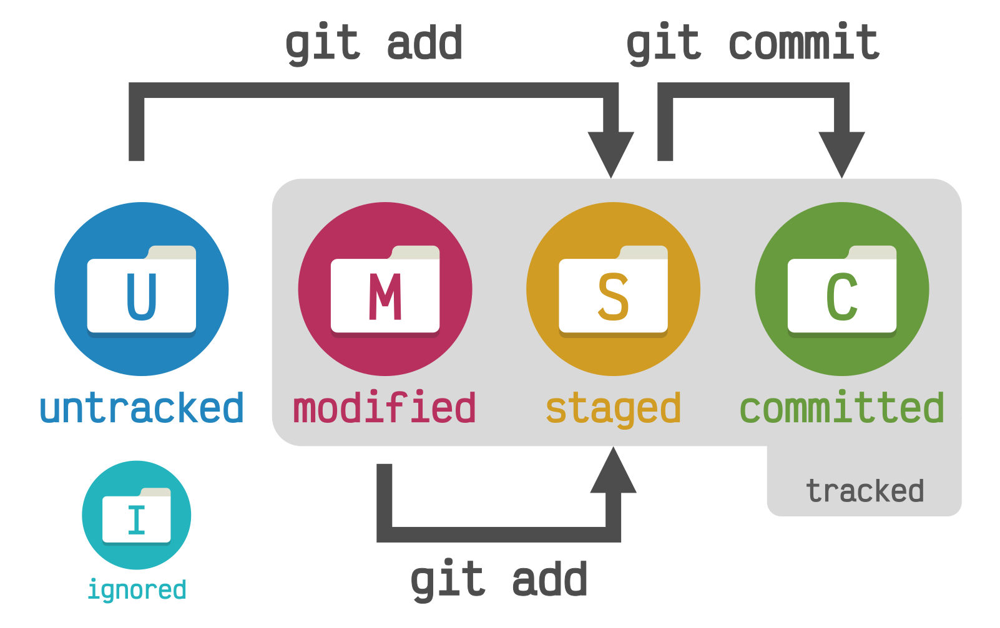

| Estado | Explicación |
| --- | --- |
| `ignored` | Ignorado |
| `tracked` | Con seguimiento |
| `untracked` | Sin seguimiento |
| `modified` | Modificado |
| `staged` | Preparado (`git add`) |
| `committed` | Confirmado (`git commit`) |

### Preparar cambios

El comando **`git add`**[:octicons-link-external-16:](https://git-scm.com/docs/git-add) es el que se utiliza para **preparar archivos** (subir al escenario[^2] :thinking:) dentro del control de versiones.

```console
$ git add README.md
```

Ahora volvemos a comprobar el estado del repositorio:

```console hl_lines="7"
$ git status
On branch main
Your branch is up to date with 'origin/main'.
 
Changes to be committed:
  (use "git restore --staged [file]..." to unstage)
  modified:   README.md
```

Es posible preparar **todos los cambios de una sola vez** con el siguiente comando:

```console
$ git add .
```

### Confirmar cambios

El comando **`git commit`**[:octicons-link-external-16:](https://git-scm.com/docs/git-commit) es el que se utiliza para **confirmar cambios** dentro del control de versiones.

Cuando hemos preparado el archivo podemos «commitearlo» (confirmarlo) mediante un mensaje informativo. Es importante que este mensaje sea lo [suficientemente claro](#buenas-practicas-en-commits) para que de una idea rápida y general de lo que estamos haciendo:

```console
$ git commit -m "Add welcome message"
[main ae0abb3] Add welcome message
1 file changed, 1 insertion(+)
```

!!! tip "Opción `-m`"

    Si no se especifica la opción `-m` el comando pedirá el mensaje de confirmación abriendo un editor (habitualmente definido en la variable de entorno `$EDITOR`).

Ahora volvemos a comprobar el estado del repositorio:

```console hl_lines="6"
$ git status
On branch main
Your branch is ahead of 'origin/main' by 1 commit.
  (use "git push" to publish your local commits)
 
nothing to commit, working tree clean
```

Si solo se quiere confirmar los ^^cambios efectuados en archivos que ya están en seguimiento^^, es posible ~~saltarse~~ incluir el `git add` utilizando el modificador `-a`:

```console
$ git commit -am "Fast"
```

#### Alterando el commit

Imagina por un momento que te olvidas de incluir un cambio en el último _commit_. Pues afortunadamente `git` te ofrece una solución mediante el modificador `--amend`:

1. Haz los cambios que necesites.
2. Prepara los cambios con `git add .`
3. Vuelve a hacer _commit_ pero esta vez: `git commit --amend`

Existe una **opción desatendida** con `git commit --amend --no-edit` que no preguntará por un nuevo mensaje de confirmación sino que utilizará el último que hayas realizado.

### Restaurar cambios

El comando **`git restore`**[:octicons-link-external-16:](https://git-scm.com/docs/git-restore) es el que se utiliza para **restaurar cambios** dentro del control de versiones.

Hay que diferenciar dos escenarios a la hora de **restaurar cambios**:

=== "Archivos sin preparar"

    Hemos modificado `README.md` pero aún está sin preparar:

    ```console
    $ git restore README.md
    ```

    Con esto conseguimos volver al estado «neutro»:

    ```console hl_lines="5"
    $ git status
    On branch main
    Your branch is up to date with 'origin/main'.
     
    nothing to commit, working tree clean
    ```

=== "Archivos ya preparados"

    Hemos modificado `README.md` y lo hemos preparado:

    ```console hl_lines="7"
    $ git status
    On branch main
    Your branch is up to date with 'origin/main'.
     
    Changes to be committed:
      (use "git restore --staged [file]..." to unstage)
      modified:   README.md
    ```

    Utilizamos el modificador `--staged` para restaurar:

    ```console
    $ git restore --staged README.md
    $ git restore README.md
    ```

    Con esto conseguimos volver al estado «neutro»:

    ```console hl_lines="5"
    $ git status
    On branch main
    Your branch is up to date with 'origin/main'.
     
    nothing to commit, working tree clean
    ```

Existe la posibilidad de «restaurar todo» mediante el comando `git restore .`

### Borrar archivos

El comando **`git clean`**[:octicons-link-external-16:](https://git-scm.com/docs/git-clean) es el que se utiliza para **borrar archivos** dentro del control de versiones.

Supongamos que el escenario actual es el siguiente:

```console hl_lines="7-8"
$ git status
On branch main
Your branch is up to date with 'origin/main'.
 
Untracked files:
  (use "git add [file]..." to include in what will be committed)
  process.C
  upload.C
 
nothing added to commit but untracked files present (use "git add" to track)
```

Podemos proceder al borrado de la siguiente manera:

```console hl_lines="3 6 8"
$ git clean -i
Would remove the following items:
  process.C  upload.C
*** Commands ***
  1: clean                2: filter by pattern
  3: select by numbers    4: ask each
  5: quit                 6: help
What now> 4
Remove process.C [y/N]? y
Remove upload.C [y/N]? y
Removing process.C
Removing upload.C
```

Si se utiliza `git clean -f` se forzará a borrar los archivos sin dar opciones.

### Gestionar ramas

Una rama («branch») es una **línea de desarrollo independiente** dentro de un repositorio, que permite trabajar en nuevas funcionalidades o realizar cambios sin afectar directamente a otras líneas de desarrollo.

A continuación se muestra un esquema de cómo funcionan las ramas en control de versiones:

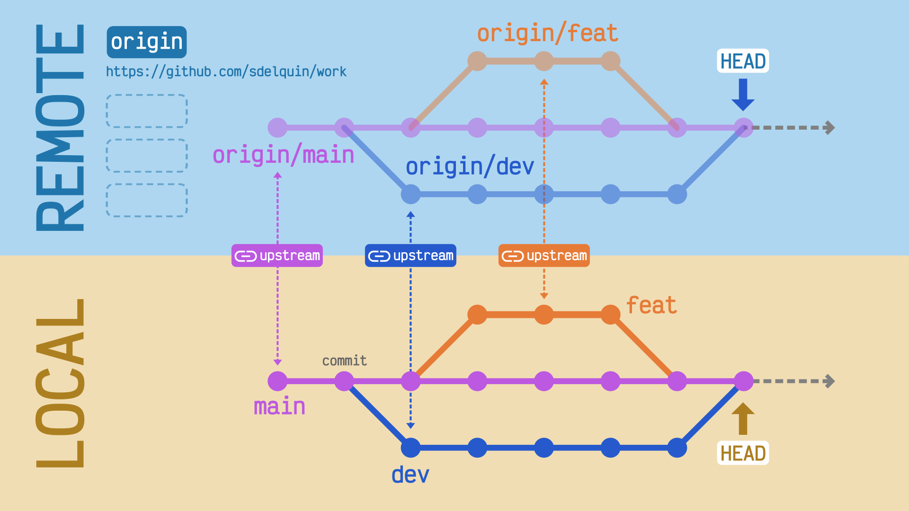

El comando **`git branch`**[:octicons-link-external-16:](https://git-scm.com/docs/git-branch) es el que se utiliza para **gestionar ramas** dentro del control de versiones.

#### Consultar ramas

Veamos cómo consultar las ramas actuales:

=== "Ramas locales :material-home:"

    ```console
    $ git branch
    * main
    ```    

=== "Ramas remotas :material-cloud:"

    ```console
    $ git branch -r
    origin/main
    ```

=== "Todas las ramas :octicons-git-branch-16:"

    ```console
    $ git branch -a
    *main
    remotes/origin/main
    ```

=== "Ramas y detalles :material-magnify:"

    ```console
    $ git branch -avv
    * main                788a2d7 [origin/main] Initial commit
      remotes/origin/main 788a2d7 Initial commit
    ```    
    
#### Crear y borrar ramas

Veamos cómo crear y borrar ramas:

=== "Crear ramas :material-creation-outline:"

    ```console
    $ git branch dev
    $ git branch feat
    ```

    Si ahora consultamos el estado de las ramas:

    ```console
    $ git branch
      dev
      feat
    * main
    ```

=== "Borrar ramas :material-delete:"

    ```console
    $ git branch -d dev
    Deleted branch dev (was ae0abb3).
    $ git branch -d feat
    Deleted branch feat (was ae0abb3).
    ```

    Si ahora consultamos el estado de las ramas:

    ```console
    $ git branch
    *main
    ```

### Gestionar remotos

El comando **`git remote`**[:octicons-link-external-16:](https://git-scm.com/docs/git-remote) es el que se utiliza para **gestionar las direcciones remotas** («remote» o simplemente _remotos_) dentro del control de versiones.

#### Consultar remotos

<div class="annotate" markdown>
```console
$ git remote -v
origin	git@github.com:sdelquin/work.git (fetch)(1)
origin	git@github.com:sdelquin/work.git (push)(2)
```
</div>
1. **fetch** se usa para «traer» (descargar) los cambios.
2. **push** se usa para «enviar» (subir) los cambios.

!!! tip "Origin"

    El término `origin` usado en los remotos indica que es el _remoto_ desde el que el repositorio se clonó **originalmente**.

#### Modificar remotos

Para modificar remotos tenemos dos opciones:

=== "Vía `git`"

    ```console
    $ git remote add
    % git remote remove
    ```

=== "Vía `.git/config`"

    ```ini hl_lines="8-9"
    [core]
      repositoryformatversion = 0
      filemode = true
      bare = false
      logallrefupdates = true
      ignorecase = true
      precomposeunicode = true
    [remote "origin"]
      url = git@github.com:sdelquin/work.git
      fetch = +refs/heads/*:refs/remotes/origin/*
    [branch "main"]
      remote = origin
      merge = refs/heads/main
    [branch "dev"]
      remote = origin
      merge = refs/heads/dev
    ```
    
### Cambiar a otras ramas

El comando **`git switch`**[:octicons-link-external-16:](https://git-scm.com/docs/git-switch) es el que se utiliza para **cambiar a otras ramas** dentro del control de versiones.

A continuación se muestran dos <span class="example">ejemplos:material-flash:</span>[^3] mediante piezas de [LEGO](https://www.lego.com/es-es?age-gate=grown_up) para ilustrar el trabajo con ramas:

=== "Ejemplo A"

    <div class="grid cards" markdown>

    -   :one:

        ---

        ```console hl_lines="5"
        $ git branch
        * main  # pieza blanca

        $ git switch -c blue
        Switched to a new branch 'blue'

        $ git branch
        * blue
        main
        ```

        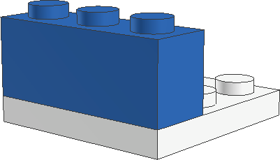

    -   :two:

        ---

        ```console hl_lines="7"
        $ git switch -c red
        Switched to a new branch 'red'

        $ git branch
        blue
        main
        * red
        ```

        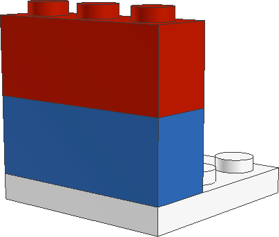
    </div>

=== "Ejemplo B"

    <div class="grid cards" markdown>

    -   :one:

        ---

        ```console hl_lines="13"
        $ git switch main
        Switched to branch 'main'
        
        $ git switch -c blue
        Switched to a new branch 'blue'

        $ git switch main
        Switched to branch 'main'

        $ git switch -c red
        Switched to a new branch 'red'
        
        $ git status
        blue
        main
        * red
        ```

        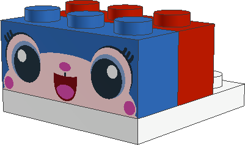

    -   :two:

        ---

        ```console
        $ git switch blue
        $ git commit
        $ git commit
        $ git switch -c green
        $ git commit
        $ git switch red
        $ git commit
        $ git commit
        $ git commit
        ```

        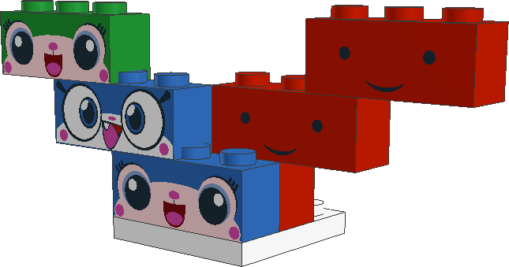
    </div>

!!! tip "Volviendo a la rama anterior"

    Con el comando **`git switch -`** volvemos a la rama anterior.    

### Subir cambios

El comando **`git push`**[:octicons-link-external-16:](https://git-scm.com/docs/git-push) es el que se utiliza para **subir cambios** (desde _local_ a _upstream_) dentro del control de versiones.

```console
$ git push
Enumerating objects: 5, done.
Counting objects: 100% (5/5), done.
Delta compression using up to 8 threads
Compressing objects: 100% (2/2), done.
Writing objects: 100% (3/3), 340 bytes | 340.00 KiB/s, done.
Total 3 (delta 0), reused 0 (delta 0), pack-reused 0
To github.com:sdelquin/work.git
  bdede5e..ae0abb3  main -> main
```

Podemos [consultar el estado de la rama](#consultar-ramas) utilizando lo siguiente:

```console hl_lines="2"
$ git branch -vv
* main ae0abb3 [origin/main] Add welcome message
```

Analicemos esta línea en sus distintos componentes:

| Elemento | Descripción |
| --- | --- |
| `main` | Rama local actualmente seleccionada |
| `ae0abb3` | _Hash_ identificativo del último _commit_ |
| `[origin/main]` | _Upstream_ sobre el que se «pusheó» (subió) el cambio |
| `Add welcome message` | Mensaje informativo del _commit_ |

#### Establecer upstream

Nos podemos encontrar con escenarios donde la rama de trabajo no dispone de _upstream_:

```console hl_lines="5"
$ git switch -c dev
Switched to a new branch 'dev'

$ git push
fatal: The current branch dev has no upstream branch.
To push the current branch and set the remote as upstream, use

    git push --set-upstream origin dev
```

Podemos [consultar el estado de la rama](#consultar-ramas) y comprobar que efectivamente no dispone de _upstream_ definido:

```console hl_lines="2"
$ git branch -vv
* dev  ae0abb3 Add welcome message
  main ae0abb3 [origin/main] Add welcome message
```

Para fijar un _upstream_ podemos utilizar el modificador `-u` $\Leftrightarrow${.middle} `--set-upstream`:

```console hl_lines="9"
$ git push -u origin dev
Total 0 (delta 0), reused 0 (delta 0), pack-reused 0
remote:
remote: Create a pull request for 'dev' on GitHub by visiting:
remote:      https://github.com/sdelquin/work/pull/new/dev
remote:
To github.com:sdelquin/work.git
* [new branch]      dev -> dev
Branch 'dev' set up to track remote branch 'dev' from 'origin'.

```

Confirmamos este cambio [consultando el estado de la rama](#consultar-ramas):

```console hl_lines="2"
$ git branch -vv
* dev  ae0abb3 [origin/dev] Add welcome message
  main ae0abb3 [origin/main] Add welcome message
```

### Mezclar ramas

El comando **`git merge`**[:octicons-link-external-16:](https://git-scm.com/docs/git-merge) es el que se utiliza para **mezclar cambios desde otra rama** dentro del control de versiones.

#### Mezcla sin conflictos

En este <span class="example">ejemplo:material-flash:</span> se mezclan los cambios de la rama `dev` dentro de la rama `main` sin que aparezca ningún conflicto:

<div class="grid" markdown>

```console
$ git switch dev

$ # edit README.md
$ git add .
$ git commit -m "New notes"

$ git switch main

$ git merge dev --no-edit
Merge made by the 'recursive' strategy.
README.md | 1 +
1 file changed, 1 insertion(+)
```

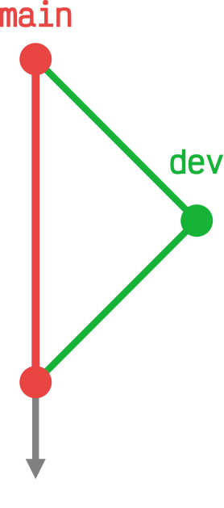{ width="100" align="middle" }

</div>

#### Mezcla con conflictos

En este <span class="example">ejemplo:material-flash:</span> se mezclan los cambios de la rama `dev` dentro de la rama `main` pero aparece un **conflicto** debido a un cambio previo realizado en la rama `main`:

<div class="grid" markdown>

```console hl_lines="13"
$ git switch dev
$ # Editamos L2 de README.md: "Hola" 
$ git add .
$ git commit -m "Say hola"

$ git switch main
$ # Editamos L2 de README.md: "Hallo" 
$ git add .
$ git commit -m "Say hallo"

$ git merge dev --no-edit
Auto-merging README.md
CONFLICT (content): Merge conflict in README.md
Automatic merge failed; fix conflicts and then commit the result.
```

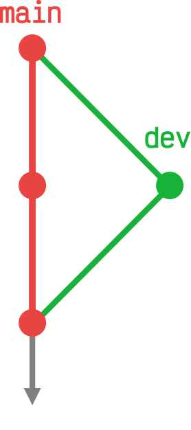{ width="100" }

</div>

Para **resolver el conflicto** tendremos que editar el fichero `README.md` (fichero con conflicto):

<div class="grid" markdown>

```markdown title="README.md" hl_lines="1-6"
<<<<<<< HEAD
Hallo
||||||| 8f1e81f
=======
Hola
>>>>>>> dev
Just for testing purposes
Hello World!
Changes from dev branch
Keep on working
```

```markdown title="README.md" hl_lines="1"
Hola
Just for testing purposes
Hello World!
Changes from dev branch
Keep on working
```
</div>

??? success "Ayuda del IDE"

    Existen IDEs como [Visual Studio Code](../ide/vscode.md) que facilitan la gestión de los conflictos mostrando opciones en el propio editor del fichero:

    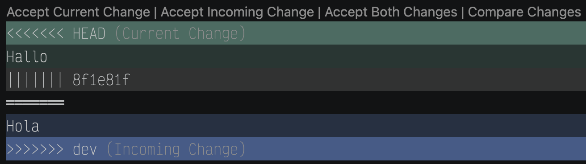

Una vez que hemos guardado los cambios en `README.md` tendremos que indicar a `git` que el conflicto está resuelto:

<div class="grid" markdown>

```console title="Comprobar estado actual" hl_lines="10-12"
$ git status
On branch main
Your branch is ahead of 'origin/main' by 3 commits.
  (use "git push" to publish your local commits)
 
You have unmerged paths.
  (fix conflicts and run "git commit")
  (use "git merge --abort" to abort the merge)
 
Unmerged paths:
  (use "git add [file]..." to mark resolution)
  both modified:   README.md
 
no changes added to commit (use "git add" and/or "git commit -a")
```

```console title="Preparar y confirmar cambios"
$ git add README.md

$ git commit -m "Fix conflict"
[main 101d7fb] Fix conflict
 1 file changed, 1 insertion(+), 1 deletion(-)
```

</div>

### Actualizar cambios remotos

El comando **`git pull`**[:octicons-link-external-16:](https://git-scm.com/docs/git-pull) es el que se utiliza para **actualizar los cambios remotos** dentro del control de versiones.

Supongamos el siguiente <span class="example">ejemplo:material-flash:</span>:

<div class="grid cards" markdown>

-   Esquema de situación

    ---

    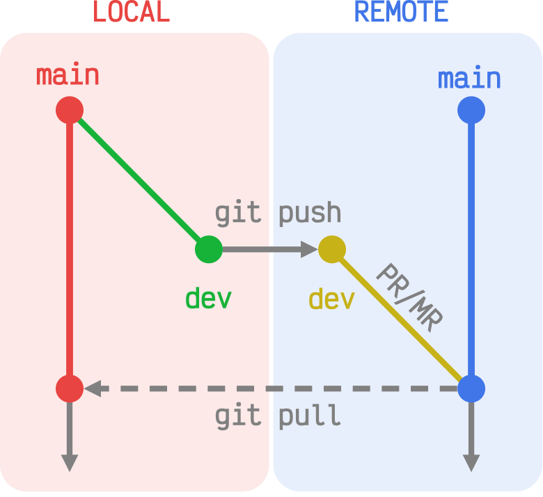

-   Procedimiento

    ---

    ```console
    $ git switch dev
    $ # edit README.md
    $ git add .
    $ git commit
    $ git push
    ```

    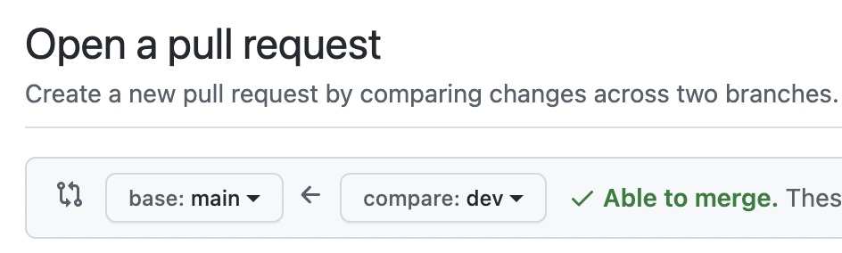

    ```console
    $ git switch main
    $ git pull
    ```

</div>

#### Pull Request

Veamos a continuación los pasos a seguir para crear un _Pull Request_ (PR)[^4] en [GitHub](https://docs.github.com/es/pull-requests/reference/pull-requests):

=== "Elección de rama"

    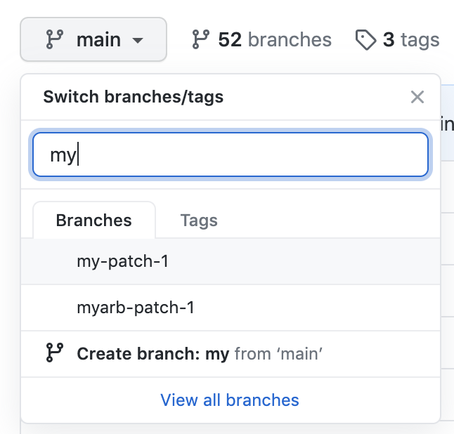

=== "«Pull request»"

    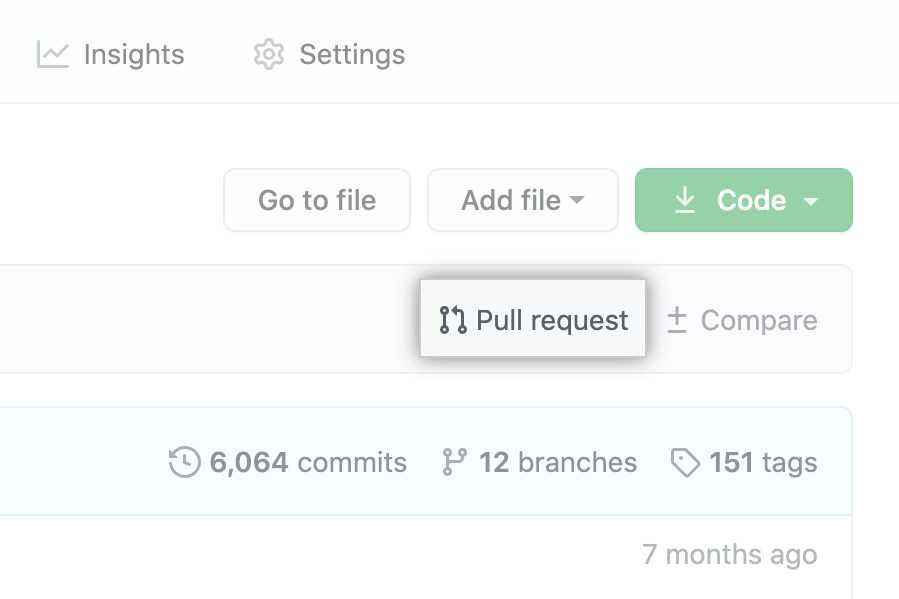

=== "Comparar ramas"

    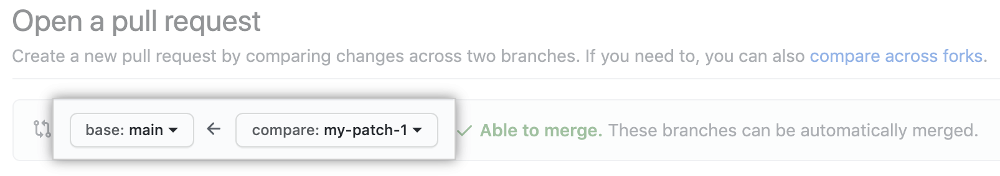

=== "Descripción"

    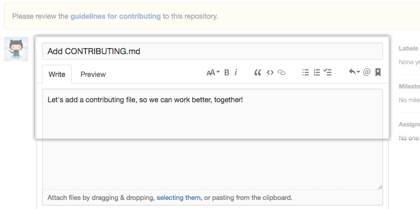
    
=== "Envío"

    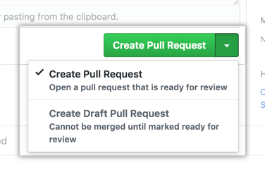
            
Puede que algunas capturas de pantalla no coincidan con la versión actual.

!!! tip "Equivalencia"

    Se cumple que: `git pull = git fetch + git merge`    

### Traer cambios

El comando **`git fetch`**[:octicons-link-external-16:](https://git-scm.com/docs/git-fetch) es el que se utiliza para **traer cambios a local** dentro del control de versiones.

A continuación se muestra la aplicación de este comando en dos escenarios distintos de colaboración:

:a: Con permisos de escritura.  
:b: Sin permisos de escritura.

#### Colaboración con permisos de escritura

Esta forma de colaborar en un repositorio suele ser habitual para **miembros de un equipo**, donde todos tienen permisos de escritura sobre el repositorio.

Desde la **perspectiva del colaborador** `euribates` haríamos lo siguiente:

<div class="grid" markdown>

```console title="Colaborador"
$ # git clone ...
$ git switch -c colab
$ # edit README.md
$ git add .
$ git commit -m "Help from teammate"
$ git push origin colab
```

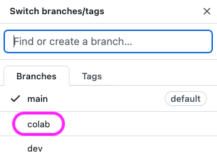
/// caption
¡Nueva rama remota!
///

</div>

Desde la **perspectiva del propietario del repositorio** `sdelquin` haríamos lo siguiente:

```console hl_lines="7 14 19 23 28"
$ git branch -avv    
  dev                 3149c76 [origin/dev] Work in progress
* main                7c3682f [origin/main] Add sum
  remotes/origin/dev  3149c76 Work in progress
  remotes/origin/main 7c3682f Add sum

$ git fetch
remote: Enumerating objects: 5, done.
remote: Counting objects: 100% (5/5), done.
remote: Compressing objects: 100% (2/2), done.
remote: Total 3 (delta 1), reused 3 (delta 1), pack-reused 0
Unpacking objects: 100% (3/3), 353 bytes | 88.00 KiB/s, done.
From github.com:sdelquin/work
* [new branch]      colab      -> origin/colab

$ git branch -avv    
  dev                   3149c76 [origin/dev] Work in progress
* main                  7c3682f [origin/main] Add sum
  remotes/origin/colab  46b7b56 Help from teammate
  remotes/origin/dev    3149c76 Work in progress
  remotes/origin/main   7c3682f Add sum

$ git switch colab
Branch 'colab' set up to track remote branch 'colab' from 'origin'.
Switched to a new branch 'colab'

$ git branch -avv    
* colab                 46b7b56 [origin/colab] Help from outside
  dev                   3149c76 [origin/dev] Work in progress
  main                  7c3682f [origin/main] Add sum
  remotes/origin/colab  46b7b56 Help from teammate
  remotes/origin/dev    3149c76 Work in progress
  remotes/origin/main   7c3682f Add sum
```

#### Colaboración sin permisos de escritura

Esta forma de colaborar en un repositorio suele ser habitual para personal externo que no dispone de permisos de escritura sobre el repositorio.

Desde la **perspectiva del colaborador** `euribates` haríamos lo siguiente:

=== "Crear un _fork_ :fontawesome-solid-code-fork:"

    Un «fork» es una **copia** del proyecto —independiente— pero con referencias al original.

    <div class="grid" markdown>
    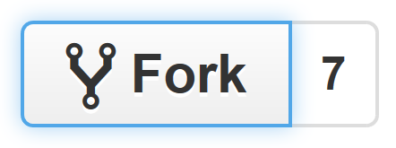
    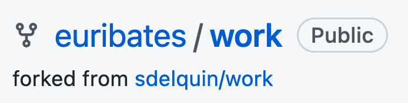
    </div>
    
=== "Clonar el _fork_ :fontawesome-regular-clone:"

    ```console hl_lines="1-2 5-7"
    $ git clone git@github.com:euribates/work.git
    $ git switch -c examples-proposal
    $ # edit README.md
    $ # add examples.md
    $ git add .
    $ git commit -m "A new samples page"
    $ git push origin examples-proposal
    $ # Create PR
    ```

=== "Envío de PR :material-source-pull:"

    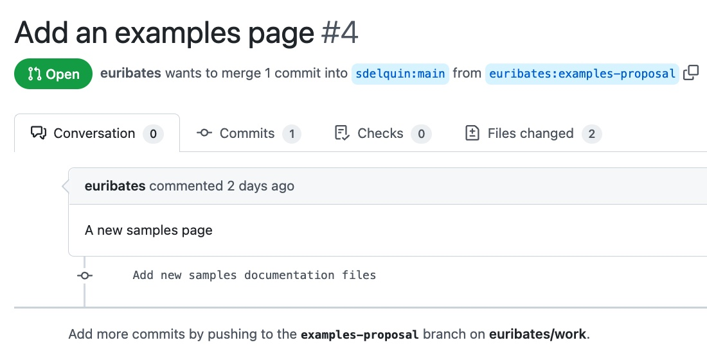    
    

Desde la **perspectiva del propietario del repositorio** `sdelquin` haríamos lo siguiente:

=== "Consultar ramas :octicons-git-branch-16:"

    ```console
    $ git branch -avv    
      dev                 3149c76 [origin/dev] Work in progress
    * main                7c3682f [origin/main] Add sum
      remotes/origin/dev  3149c76 Work in progress
      remotes/origin/main 7c3682f Add sum
    ```

=== "Añadir remoto :material-cloud:"

    ```console hl_lines="1 4-5"
    $ git remote add euribates https://github.com/euribates/work.git

    $ git remote -v
    euribates	https://github.com/euribates/work.git (fetch)
    euribates	https://github.com/euribates/work.git (push)
    origin	git@github.com:sdelquin/work.git (fetch)
    origin	git@github.com:sdelquin/work.git (push)
    ```

=== "Traer rama :material-source-branch-plus:"

    ```console hl_lines="4 9 12"
    $ git fetch euribates examples-proposal
    From github.com:euribates/work
    * branch            examples-proposal -> FETCH_HEAD
    * [new branch]      examples-proposal -> euribates/examples-proposal
    
    $ git branch -r | grep euribates
    euribates/examples-proposal

    $ git switch examples-proposal
    Branch 'examples-proposal' set up to track remote branch
    'examples-proposal' from 'euribates'.
    Switched to a new branch 'examples-proposal'
    ```

=== "Revisar cambios :simple-quicklook:"

    ```console hl_lines="9 19-20"
    $ git status
    On branch examples-proposal
    Your branch is up to date with 'euribates/examples-proposal'.
     
    nothing to commit, working tree clean

    $ ls
    LICENSE
    README.md
    examples.md
    sum.py

    $ # edit examples.md
    $ git add .
    $ git commit -m "PR checked"

    $ git push
    # ...
    To github.com:euribates/work.git
      916c79c..48bfdf2  examples-proposal -> examples-proposal
    ```

=== "Pull Request :material-source-pull:"

    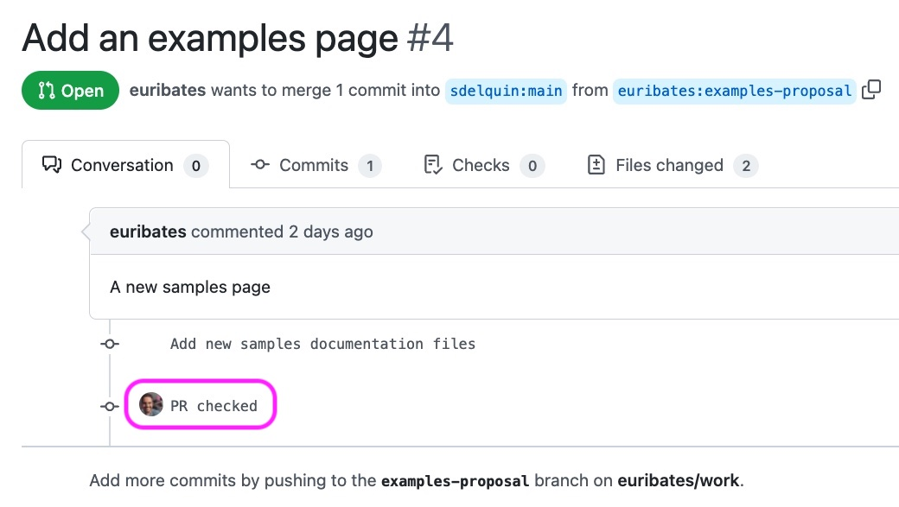    

### Almacenar cambios

El comando **`git stash`**[:octicons-link-external-16:](https://git-scm.com/docs/git-stash) es el que se utiliza para **almacenar temporalmente los cambios** dentro del control de versiones.

Veamos a continuación un <span class="example">ejemplo:material-flash:</span> de aplicación:

=== "Consultar estado"

    Consultamos el estado actual del repositorio y podemos comprobar que existe un fichero `config.py` que está sin seguimiento:

    ```console hl_lines="1 5 8 10 12"
    $ git status
    On branch main
    Your branch is up to date with 'origin/main'.
    
    Changes not staged for commit:
    (use "git add [file]..." to update what will be committed)
    (use "git restore [file]..." to discard changes in working directory)
    modified:   README.md
    
    Untracked files:
    (use "git add [file]..." to include in what will be committed)
    config.py
    
    no changes added to commit (use "git add" and/or "git commit -a")
    ```

=== "Almacenar cambios"

    Guardamos los cambios utilizando una variante `git stash -u` (`--include-untracked`) que permite incluir los archivos sin seguimiento:

    ```console hl_lines="1 9"
    $ git stash -u
    Saved working directory and index state WIP on main:
    c18e3f7 Merge branch 'main' of github.com:sdelquin/work

    $ git status
    On branch main
    Your branch is up to date with 'origin/main'.
     
    nothing to commit, working tree clean
    ```

=== "Extraer cambios"

    En cualquier momento podremos volver a aplicar los cambios que están guardados en el «stash»:

    ```console hl_lines="1 5 8 12"
    $ git stash pop
    On branch main
    Your branch is up to date with 'origin/main'.
     
    Changes not staged for commit:
      (use "git add [file]..." to update what will be committed)
      (use "git restore [file]..." to discard changes in working directory)
      modified:   README.md
     
    Untracked files:
      (use "git add [file]..." to include in what will be committed)
      config.py
     
    no changes added to commit (use "git add" and/or "git commit -a")
    Dropped refs/stash@{0} (eb45cfdc63836cbc6417c358780ba55722c795b3)
    ```

### Mostrar el historial    

El comando **`git log`**[:octicons-link-external-16:](https://git-scm.com/docs/git-log) es el que se utiliza para **mostrar el historial de cambios** dentro del control de versiones.

A continuación se muestran dos <span class="example">ejemplo:material-flash:</span> de aplicación del comando, dentro de las muchas opciones que presenta:

=== "En una línea"

    ```console
    $ git log --oneline
    c18e3f7 (HEAD -> main) Merge branch 'main' of github.com:sdelquin/work
    1705ee9 (origin/main) Merge pull request #2 from sdelquin/dev
    3149c76 (origin/dev, dev) Work in progress
    101d7fb Fix conflict
    24c1201 Say hallo
    66c4e10 Say hola
    aa94f74 Merge branch 'dev'
    8f1e81f New notes
    e44f857 Merge pull request #1 from sdelquin/dev
    e8983c7 More changes
    ae0abb3 Add welcome message
    bdede5e Initial commit
    ```

=== "En formato corto"

    ```console
    $ git shortlog
    Sergio Delgado Quintero (13):
          Initial commit
          Add welcome message
          More changes
          Merge pull request #1 from sdelquin/dev
          New notes
          Merge branch 'dev'
          Say hola
          Say hallo
          Fix conflict
          Work in progress
          Merge pull request #2 from sdelquin/dev
          Merge branch 'main' of github.com:sdelquin/work
    ```    

### Encontrar diferencias

El comando **`git diff`**[:octicons-link-external-16:](https://git-scm.com/docs/git-diff) es el que se utiliza para **encontrar diferencias** dentro del control de versiones.

#### Diferencias actuales

Supongamos por <span class="example">ejemplo:material-flash:</span> que hacemos un pequeño cambio en el fichero `README.md`:

<div class="grid" markdown>

```console linenums="1" title="README.md" hl_lines="4"
# work
Hola
Just for testing purposes
Hello World!
Changes from dev branch
Keep on working
Work in progress
```

```console linenums="1" title="README.md*" hl_lines="4"
# work
Hola
Just for testing purposes
Ciao Mondo!
Changes from dev branch
Keep on working
Work in progress
```

</div>

Podemos extraer las diferencias[^5] de la siguiente manera:

```console
$ git diff
diff --git a/README.md b/README.md
index 4ed5232..bb48069 100644
--- a/README.md
+++ b/README.md
@@ -1,7 +1,7 @@
# work
Hola
Just for testing purposes
-Hello World!
+Ciao Mondo!
Changes from dev branch
Keep on working
Work in progress 
```

#### Diferencias históricas

Igualmente podemos encontrar diferencias entre distintos _commits_ en el historial del repositorio:

```console hl_lines="3 6"
$ git log --oneline
...
24c1201 Say hallo
66c4e10 Say hola
aa94f74 Merge branch 'dev'
8f1e81f New notes
...
```

| Comparación | Comando |
| --- | --- |
| 24c1201 _vs_ HEAD | `#!console git diff 24c1201` |
| 8f1e81f _vs_ HEAD :material-slash-forward:fichero:material-slash-forward: | `#!console git diff 8f1e81f README.md` |
| 24c1201 _vs_ 8f1e81f | `#!console git diff 24c1201 8f1e81f` |
| 24c1201 _vs_ 8f1e81f :material-slash-forward:fichero:material-slash-forward: | `#!console git diff 24c1201 8f1e81f README.md` |

### Recuperar versiones

El comando **`git checkout`**[:octicons-link-external-16:](https://git-scm.com/docs/git-checkout) es el que se utiliza para **recuperar versiones** dentro del control de versiones.

<div class="grid" markdown>

```console title="Código"
$ git checkout 24c1201
Note: switching to '24c1201'.
...
...
HEAD is now at 24c1201 Say hallo

$ git checkout -
Previous HEAD position was 24c1201 Say hallo
Switched to branch 'main'
```

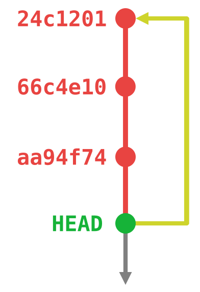{width=200}

</div>

!!! warning "Advertencia"

    Cuidado con **reescribir** la historia.

### Etiquetar versiones

El comando **`git tag`**[:octicons-link-external-16:](https://git-scm.com/docs/git-tag) es el que se utiliza para **etiquetar versiones (o hitos)** dentro del control de versiones.

<div class="grid" markdown>

```console title="Código" hl_lines="6"
$ vi sum.py  # nueva funcionalidad

$ git add sum.py
$ git commit -m "Add sum"

$ git tag -a 1.0.0 -m "Release version 1.0.0"

$ git tag
1.0.0
```

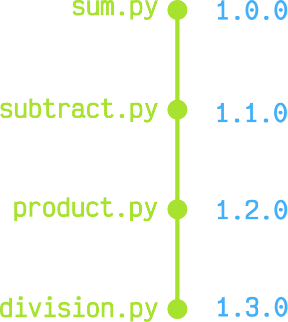{width="200"}

</div>

!!! tip "Subiendo etiquetas"

    Si queremos que nuestras etiquetas se suban al correspondiente _remoto_ debemos ejecutar:

    ```console
    $ git push --follow-tags
    ```

#### Versionado semántico

El [versionado semántico](https://semver.org/lang/es/) es ampliamente utilizado en proyectos de software y consiste en determinar cada _release_ del proyecto por tres números en el formato `MAJOR.MINOR.PATCH`.

1. La versión `MAJOR` (mayor) se incrementa cuando se realiza un cambio incompatible con versiones anteriores.
2. La versión `MINOR` (menor) se incrementa cuando se añade funcionalidad compatible con versiones anteriores.
3. La versión `PATCH` (parche) se incrementa cuando se reparan errores compatibles con versiones anteriores.

!!! example "Releases en GitHub"

    Apoyándonos en el propio `git tag` podemos [definir nuevas _releases_](https://docs.github.com/es/repositories/releasing-projects-on-github/managing-releases-in-a-repository) en la página de GitHub.

### Mostrar autoría de cambios

El comando **`git blame`**[:octicons-link-external-16:](https://git-scm.com/docs/git-blame) es el que se utiliza para **mostrar la autoría de los cambios**[^6] dentro del control de versiones.

```console
$ git blame README.md
^bdede5e (Sergio Delgado Quintero 2022-05-05 09:58:55 +0100 1) # work
66c4e102 (Sergio Delgado Quintero 2022-05-06 13:42:19 +0100 2) Hola
^bdede5e (Sergio Delgado Quintero 2022-05-05 09:58:55 +0100 3) Just for testing purposes
ae0abb3a (Sergio Delgado Quintero 2022-05-05 12:51:16 +0100 4) Hello World!
e8983c79 (Sergio Delgado Quintero 2022-05-06 13:12:55 +0100 5) Changes from dev branch
8f1e81f6 (Sergio Delgado Quintero 2022-05-06 13:18:48 +0100 6) Keep on working
3149c76f (Sergio Delgado Quintero 2022-05-06 18:59:57 +0100 7) Work in progress
```

## Convenciones y buenas prácticas

En esta sección veremos algunas estrategias para mejorar el flujo de trabajo del control de versiones.

### Estructura de un repositorio

Aunque no existe un consenso para esto ni ningún estándar definido, la estructura **mínima** de un repositorio debería contener los siguientes ficheros:

| Fichero | Explicación |
| --- | --- |
| `README.md` | Descripción del proyecto[^7] |
| `LICENSE` | Licencia del proyecto[^8] |
| `CHANGELOG` | [Fichero de cambios](#changelog) |
| `.gitignore` | Ficheros ignorados para el control de versiones |

### Changelog

El archivo `CHANGELOG` suele recoger los cambios en el proyecto organizados por fechas y versiones. Se trata de una buena práctica recogida en [esta iniciativa](https://keepachangelog.com/).

A continuación podemos ver un <span class="example">ejemplo:material-flash:</span> de fichero de cambios:

```markdown title="CHANGELOG"
# Changelog
All notable changes to this project will be documented in this file.
 
## [Unreleased]
 
## [1.0.0] - 2017-06-20
### Added
- New visual identity by [@tylerfortune8](https://github.com/tylerfortune8).
- Links to latest released version in previous versions.
- Version navigation. [#141](https://github.com/foo/bar/issues/141)
 
### Changed
- Start using "changelog" over "change log" since it's the common usage.
- Rewrite "What makes unicorns cry?" section.
 
### Removed
- Section about "changelog" vs "CHANGELOG".
```

El código anterior tiene su «render» directamente en GitHub:

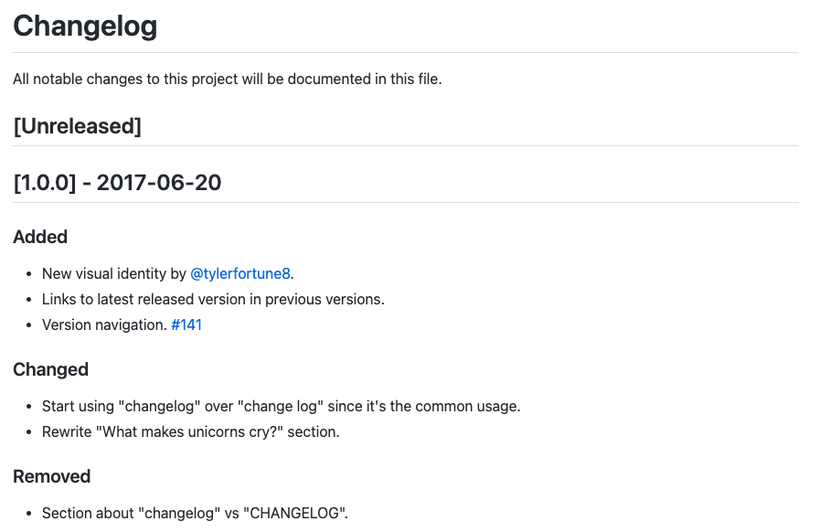

### Ignorar archivos en control de versiones

En el fichero `.gitignore` podemos utilizar [distintos patrones](https://www.atlassian.com/es/git/tutorials/saving-changes/gitignore) que nos permiten incluir/excluir según determinadas preferencias:

```python title=".gitignore"
supersecret.dat#(1)!
*.log#(2)!
**/output/*.obj#(3)!
/env#(4)!
cache#(5)!
cache/#(6)!
!cache/important.txt#(7)!
```
{ .annotate }

1. Ignora todos los archivos con el nombre `supersecret.dat`
2. Ignora todos los archivos con extensión `.log`
3. Ignora todos los archivos con extensión `.obj` dentro de carpetas «intermedias» `output`
4. Ignora el fichero `env` en el raíz del proyecto
5. Ignora todos los ficheros con el nombre `cache`
6. Ignora todas las carpetas con el nombre `cache`
7. No ignora el archivo `important.txt` dentro de la carpeta `cache`

Es **fundamental** prestar atención y **no incluir ficheros sensibles** dentro del control de versiones. Lo que **no debería**{.red} estar en el control de versiones de un repositorio:

- Contraseñas o credenciales:

        .env

- Archivos generados:

        /node_modules /packages
        *.pyc *.class
        /bin /out /target
        *.log *.lock *.tmp

- Archivos multimedia:

        .DS_Store Thumbs.db
        .artwork

- Archivos de configuración IDE:

        .idea
        .vscode
        .vimrc

### Buenas prácticas en commits

- [Mensajes semánticos](https://gist.github.com/joshbuchea/6f47e86d2510bce28f8e7f42ae84c716).
- Mantener el **estado funcional** tras el _commit_.
- _Commits_ ~~atómicos~~ pequeños.
- Distinguir entre _commits_ de formato _vs_ funcionalidad.
- Idioma inglés _vs_ idioma español.
- Etiquetado de versiones.

### Indicaciones a nivel de código

- Escribir código en inglés salvo que el equipo de trabajo (y futuros colaboradores) sean de habla española.
- Usar etiquetas `#TODO` para las partes de código pendientes.
- Evitar el uso de **rutas absolutas**.
- Si se detecta _código transversal_ se recomienda llevarlo a un **paquete**.
- Evitar _hardcodear_ en la medida de lo posible y llevarlo a **configuraciones** globales.

### Referencias

- [Manual de referencia Git](https://git-scm.com/docs).
- [Pro Git Book](https://git-scm.com/book/en/v2).
- [Git Command Explorer](https://gitexplorer.com/).
- [Aprende Git Branching](https://learngitbranching.js.org/).
- [Major.Minor.Patch](https://medium.com/fiverr-engineering/major-minor-patch-a5298e2e1798).
- [Visualizing Git Concepts with D3](https://onlywei.github.io/explain-git-with-d3/).
- [Una referencia visual de Git](https://marklodato.github.io/visual-git-guide/index-es.html).
- [gitm😜ji](https://gitmoji.dev/)
- [Oh Shit, Git?!](https://ohshitgit.com/)


[^1]: [¿Por qué GitHub renombró su rama _master_ a _main_?](https://www.theserverside.com/feature/Why-GitHub-renamed-its-master-branch-to-main)
[^2]: No es sencillo encontrar una traducción para «stage». En este contexto se ha pensado en «preparar».
[^3]: Fuente :material-arrow-right: [https://opensource.com/article/22/4/git-branches](https://opensource.com/article/22/4/git-branches).
[^4]: La traducción al español sería «Solicitud de cambio».
[^5]: Referencias para `git diff`: [¿Cómo leer la salida de git diff?](https://levelup.gitconnected.com/what-is-git-diff-and-how-do-we-read-the-output-69f5b2036186) y [Permisos 100644 en git](https://unix.stackexchange.com/a/450488).
[^6]: `git blame` también se puede traducir como «buscando culpables» :wink:
[^7]: [Buenas prácticas](https://github.com/jehna/readme-best-practices) para la escritura de `README.md`
[^8]: Es importante [elegir una licencia](https://choosealicense.com/) para nuestros proyectos de software.
