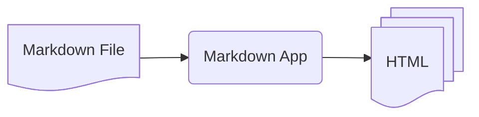

# Markdown


/// caption
Imagen generada con Inteligencia Artificial
///

Markdown es un lenguaje de marcado ligero que permite dar formato a documentos mediante una sintaxis sencilla y legible, sin necesidad de utilizar herramientas complejas. En el desarrollo de software, se utiliza ampliamente para elaborar documentación técnica, describir proyectos, redactar instrucciones de instalación y uso, y documentar código y procedimientos. Su integración con plataformas como GitHub y GitLab, junto con su facilidad de edición y su compatibilidad con sistemas de control de versiones, lo convierten en una herramienta especialmente útil para mantener la documentación de los proyectos actualizada, accesible y junto al propio código fuente.

El proceso de transformación _Markdown_ es el siguiente:



## Aplicaciones

Existen multitud de aplicaciones de Markdown en el mundo del software:

=== "Sitios web"

    Escribir sitios web en _Markdown_ es realmente cómodo y podemos encontrar soluciones.

    - Generadores estáticos de páginas como [Jekyll](https://jekyllrb.com/).
    - De hecho [GitHub Pages](https://docs.github.com/es/pages) proporciona alojamiento gratuito para sitios web hechos con **Jekyll**.

=== "Ofimática"

    Quizás no esté tan generalizado como otros softwares de ofimática general, pero hay algunas alternativas.

    - [MacDown](https://macdown.uranusjr.com/) para macOS.
    - [ReText](https://github.com/retext-project/retext) para Linux.

=== "Notas"

    Tomar notas en _Markdown_ es una de las principales aplicaciones de este lenguaje.

    - [Simplenote](https://simplenote.com/)
    - [Notable](https://notable.app/)
    - [Bear](https://bear.app/)
    - [Obsidian](https://obsidian.md/)

=== "Libros"

    Hay servicios online para transformar ficheros _Markdown_ en libro electrónico.

    - [Leanpub](https://leanpub.com/)

=== "Presentaciones"

    Generar presentaciones con _Markdown_ también es factible mediante distintas aplicaciones.

    - [Deckset](https://www.deckset.com/)
    - [Marked](https://marked2app.com/)
    - [Slidev](https://sli.dev/)

=== "Email"

    Formatear el contenido de correo electrónico con _Markdown_ es realmente interesante si se van a enviar a través de algún medio.

    - [Markdown Here](https://markdown-here.com/) es una extensión que permite convertir código _Markdown_ a HTML para tus correos.
    
=== "Documentación"

    El lugar «natural» de _Markdown_ es la documentación técnica.

    - [Read the Docs](https://about.readthedocs.com/?ref=app.readthedocs.org)
    - [Zensical](https://zensical.org/)

!!! success "Dillinger"

    Un buen punto de partida para practicar _Markdown_ es [dillinger.io](https://dillinger.io). Se trata de un editor (visualizador) online gratuito y con funcionalidades potentes.

## Sintaxis

### Encabezados

Para crear un encabezado se utiliza el símbolo almohadilla :hash: tantas veces como niveles de profundidad se quiera especificar.

| Markdown | HTML |
| --- | --- |
| `#!md # Encabezado nivel 1` | `#!html <h1>Encabezado nivel 1</h1>` |
| `#!md ## Encabezado nivel 2` | `#!html <h2>Encabezado nivel 2</h2>` |
| `#!md ### Encabezado nivel 3` | `#!html <h3>Encabezado nivel 3</h3>` |
| `#!md #### Encabezado nivel 4` | `#!html <h4>Encabezado nivel 4</h4>` |
| `#!md ##### Encabezado nivel 5` | `#!html <h5>Encabezado nivel 5</h5>` |
| `#!md ###### Encabezado nivel 6` | `#!html <h6>Encabezado nivel 6</h6>` |

### Énfasis

Existen varias opciones para indicar énfasis en el texto:

<div class="grid cards" markdown>

-   Markdown :simple-markdown:

    ---

    ```markdown
    **Negrita**
    _Cursiva_
    ***Negrita y cursiva***
    ```

    ??? info "HTML"
    
        ```html
        <strong>Negrita</strong>
        <em>Cursiva</em>
        <strong><em>Negrita y cursiva</em></strong>
        ```

-   Render :fontawesome-solid-display:

    ---

    **Negrita**  
    _Cursiva_  
    ***Negrita y cursiva***

</div>

### Citas

Una cita (_blockquote_) ofrece una estética distinta con indentación y separador vertical.

<div class="grid cards" markdown>

-   Markdown :simple-markdown:

    ---

    ```markdown
    > Ahora es mejor que nunca.
    ```

    ??? info "HTML"
    
        ```html
        <blockquote>
            <p>Ahora es mejor que nunca.</p>
        </blockquote>
        ```

-   Render :fontawesome-solid-display:

    ---

    > Ahora es mejor que nunca.

</div>

### Listas

Se puede organizar información en listas con o sin orden.

#### Listas ordenadas

<div class="grid cards" markdown>

-   Markdown :simple-markdown:

    ---

    ```markdown
    1. Bonito es mejor que feo.
    2. Explícito es mejor que implícito.
    ```

    ??? info "HTML"
    
        ```html
        <ol>
            <li>Bonito es mejor que feo.</li>
            <li>Explícito es mejor que implícito.</li>
        </ol>
        ```

-   Render :fontawesome-solid-display:

    ---

    1. Bonito es mejor que feo.
    2. Explícito es mejor que implícito.

</div>

#### Listas desordenadas

<div class="grid cards" markdown>

-   Markdown :simple-markdown:

    ---

    ```markdown
    - Bonito es mejor que feo.
    - Explícito es mejor que implícito.
    ```

    ??? info "HTML"
    
        ```html
        <ul>
            <li>Bonito es mejor que feo.</li>
            <li>Explícito es mejor que implícito.</li>
        </ul>
        ```

-   Render :fontawesome-solid-display:

    ---

    - Bonito es mejor que feo.
    - Explícito es mejor que implícito.

</div>

### Bloques de código

Para crear bloques de código hay que indentar cada línea del bloque al menos cuatro espacios o un tabulador.

<div class="grid cards" markdown>

-   Markdown :simple-markdown:

    ---

    ```
        for item in items:
            print(item)
    ```

    ??? info "HTML"
    
        ```html
        <pre>
            <code>
                for item in items:
                    print(item)
            </code>
        </pre>
        ```

-   Render :fontawesome-solid-display:

    ---

        for item in items:
            print(item)

</div>

### Reglas horizontales

Para crear una regla horizontal basta con usar tres guiones medios.

<div class="grid cards" markdown>

-   Markdown :simple-markdown:

    ---

    ```
    ---
    ```

    ??? info "HTML"
    
        ```html
        <hr />
        ```

-   Render :fontawesome-solid-display:

    ---

    ---

</div>

### Enlaces

<div class="grid cards" markdown>

-   Markdown :simple-markdown:

    ---

    ```
    [Aprende Python](https://aprendepython.es)
    ```

    ??? info "HTML"
    
        ```html
        <a href="https://aprendepython.es">Aprende Python</a>
        ```

-   Render :fontawesome-solid-display:

    ---

    [Aprende Python](https://aprendepython.es)

</div>

Si lo único que queremos es convertir una URL en un enlace podemos utilizar ángulos `<>`:

<div class="grid cards" markdown>

-   Markdown :simple-markdown:

    ---

    ```
    <https://aprendepython.es>
    ```

    ??? info "HTML"
    
        ```html
        <a href="https://aprendepython.es">https://aprendepython.es</a>
        ```

-   Render :fontawesome-solid-display:

    ---

    [https://aprendepython.es](https://aprendepython.es)

</div>

### Imágenes

<div class="grid cards" markdown>

-   Markdown :simple-markdown:

    ---

    ```
    
    ```

    ??? info "HTML"
    
        ```html
        
        ```

-   Render :fontawesome-solid-display:

    ---

    {width=200}

</div>

## Sintaxis extendida

Más allá del _Markdown_ original visto anteriormente, existe una variante (_flavour_) con [sintaxis extendida](https://www.markdownguide.org/extended-syntax/) que añade nuevas funcionalidades.

### Tablas

<div class="grid cards" markdown>

-   Markdown :simple-markdown:

    ---

    ```
    | Versión |   Fecha    |
    | ------- | ---------- |
    | 1.0.0   | 23-01-2019 |
    | 2.0.0   | 17-04-2023 |
    ```

    ??? info "HTML"
    
        ```html
        <table>
            <thead>
                <tr>
                    <th>Versión</th>
                    <th>Fecha</th>
                </tr>
            </thead>
            <tbody>
                <tr>
                    <td>1.0.0</td>
                    <td>23-01-2019</td>
                </tr>
                <tr>
                    <td>2.0.0</td>
                    <td>17-04-2023</td>
                </tr>
            </tbody>
        </table>
        ```

-   Render :fontawesome-solid-display:

    ---

    | Versión |   Fecha    |
    | ------- | ---------- |
    | 1.0.0   | 23-01-2019 |
    | 2.0.0   | 17-04-2023 |

</div>

### Bloques «vallados» de código

Aunque existe la posibilidad de añadir [bloques de código](#bloques-de-codigo) en _Markdown_ original, hay una alternativa con «vallas» donde podemos incluso especificar el lenguaje utilizado.

<div class="grid cards" markdown>

-   Markdown :simple-markdown:

    ---

        ```python
        for item in items:
            print(item)
        ```

    ??? info "HTML"
    
        ```html
        <pre>
            <code>
                for item in items:
                    print(item)
            </code>
        </pre>
        ```

-   Render :fontawesome-solid-display:

    ---

    ```python
    for item in items:
        print(item)
    ```

</div>

### Notas al pie

<div class="grid cards" markdown>

-   Markdown :simple-markdown:

    ---

    ```markdown
    Esto es una nota al pie[^1].

    [^1]: Texto explicativo.
    ```

    ??? info "HTML"
    
        ```html
        <p>
          Esto es una nota al pie
          <sup><a href="#nota-1" id="referencia-1">1</a></sup>.
        </p>
        
        <div id="nota-1">
          <p>
            <sup>1</sup> Texto explicativo.
            <a href="#referencia-1" aria-label="Volver al texto">↩</a>
          </p>
        </div>
        ```

-   Render :fontawesome-solid-display:

    ---

    Esto es una nota al pie[^1].

</div>

### Encabezados con identificadores

Ya hemos hablado de cómo escribir [encabezados](#encabezados) en _Markdown_ pero en la versión extendida es posible personalizar sus identificadores.

| Markdown | HTML |
| --- | --- |
`#!md # Encabezado nivel 1 {#nivel1}` | `#!html <h1 id="nivel1">Encabezado nivel 1</h1>` |

### Listas de definición

<div class="grid cards" markdown>

-   Markdown :simple-markdown:

    ---

    ```markdown
    Python
    : Lenguaje de propósito general

    SQL 
    : Lenguaje de propósito específico
    ```

    ??? info "HTML"
    
        ```html
        <dl>
          <dt>Python</dt>
          <dd>Lenguaje de propósito general</dd>
        
          <dt>SQL</dt>
          <dd>Lenguaje de propósito específico</dd>
        </dl>
        ```

-   Render :fontawesome-solid-display:

    ---

    Python
    : Lenguaje de propósito general

    SQL 
    : Lenguaje de propósito específico

</div>

### Tachado

<div class="grid cards" markdown>

-   Markdown :simple-markdown:

    ---

    ```markdown
    Esta ~~palabra~~ está tachada.
    ```

    ??? info "HTML"
    
        ```html
        <p>Esta <del>palabra</del> está tachada.</p>
        ```

-   Render :fontawesome-solid-display:

    ---

    Esta ~~palabra~~ está tachada.

</div>

### Listas de tareas

<div class="grid cards" markdown>

-   Markdown :simple-markdown:

    ---

    ```markdown
    - [x] Aprender Python
    - [ ] Aprender Rust
    - [ ] Aprender Gleam
    ```

    ??? info "HTML"
    
        ```html
        <ul>
          <li><input type="checkbox" checked disabled> Aprender Python</li>
          <li><input type="checkbox" disabled> Aprender Rust</li>
          <li><input type="checkbox" disabled> Aprender Gleam</li>
        </ul>
        ```

-   Render :fontawesome-solid-display:

    ---

    - [x] Aprender Python
    - [ ] Aprender Rust
    - [ ] Aprender Gleam

</div>

### Emojis

Se pueden utilizar los _códigos cortos_ ([«short codes»](https://gist.github.com/rxaviers/7360908)) de los emojis para incluirlos en _Markdown_ extendido:

<div class="grid cards" markdown>

-   Markdown :simple-markdown:

    ---

    ```markdown
    :heart: :snake: :star:
    ```

    ??? info "HTML"
    
        ```html
        <p>❤️ 🐍 ⭐</p>
        ```

-   Render :fontawesome-solid-display:

    ---

    :heart: :snake: :star:

</div>

### Destacado

<div class="grid cards" markdown>

-   Markdown :simple-markdown:

    ---

    ```markdown
    Esto es ==muy importante==
    ```

    ??? info "HTML"
    
        ```html
        <p>Esto es <mark>muy importante</mark></p>
        ```

-   Render :fontawesome-solid-display:

    ---

    Esto es ==muy importante==

</div>

### Índices

Podemos definir _subíndices_ y _superíndices_:

<div class="grid cards" markdown>

-   Markdown :simple-markdown:

    ---

    ```markdown
    H~2~O
    E=mc^2^
    ```

    ??? info "HTML"
    
        ```html
        <p>H<sub>2</sub>O</p>
        <p>E=mc<sup>2</sup></p>
        ```

-   Render :fontawesome-solid-display:

    ---

    H~2~O  
    E=mc^2^

</div>


[^1]: Texto explicativo.
