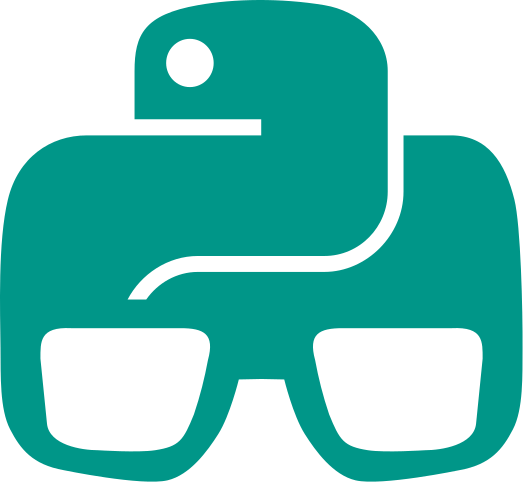

# Aprende Python

Aprende el lenguaje de programación ^^Python^^ {width=20px .beat .sub} y descubre un **mundo de posibilidades**...

///caption
Imagen generada con Inteligencia Artificial
///

Si quieres **apoyar este proyecto** te dejo dos opciones :fontawesome-solid-arrow-turn-down:{.bottom}

-   **GitHub** :simple-github:{ .acc .beat }

    ---

    [Dando una estrella :material-star-plus:](https://github.com/sdelquin/aprendepython){ .md-button .md-button--primary }

-   **Buy me a coffee** :simple-buymeacoffee:{ .acc .beat }
    
    ---

    [Pagándome un café :material-hand-coin:](https://buymeacoffee.com/sdelquin){ .md-button .md-button--primary }

!!! info "Licencia"

    :fontawesome-brands-creative-commons: :fontawesome-brands-creative-commons-by: Creative Commons Reconocimiento 4.0 Internacional: [CC BY 4.0](https://creativecommons.org/licenses/by/4.0/deed.es_ES)
